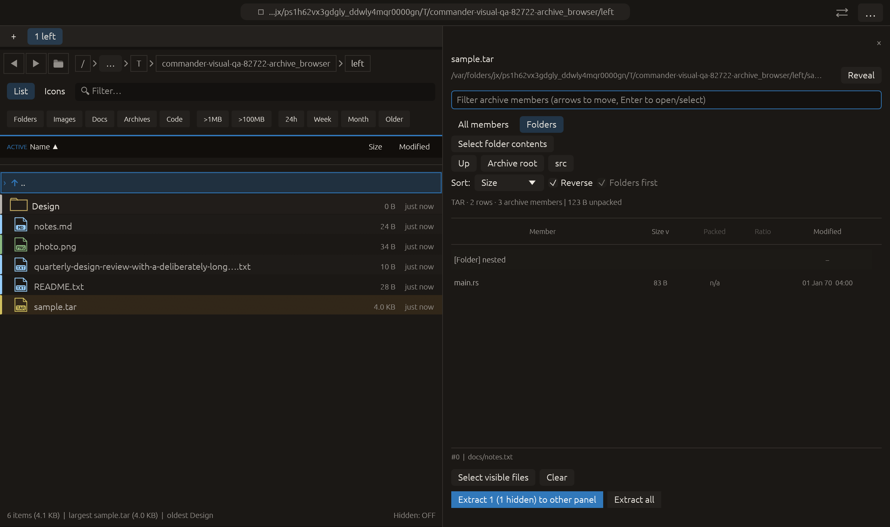

# Archive folder navigation — 2026-10-27

Independent adaptation of [Ark's folder/archive activation workflow](https://github.com/KDE/ark/blob/master/part/part.cpp).
No upstream implementation copied. All changes remain local and uncommitted.

## Delivered workflow

Default **All members** retains the flat archive list and global substring
filter. **Folders** shows direct children, including implicit folders omitted as
separate entries by archive writers. Click a folder, or move with arrows in the
filter and press Enter, to enter it. Breadcrumb components, archive root and Up
navigate back. Files retain existing size/date/packed/ratio sorting; navigation
folders stay first. Navigation resets the row cursor and scroll to the top.

Selection uses real listing IDs across folder/filter/sort changes. Outside picks
are counted as hidden by Extract selected. **Select visible files** uses the real
visible-member set only. **Select folder contents** selects the listed subtree,
including filtered-out members; component matching does not include sibling
prefixes such as `a-not` for folder `a`. Clear is archive-wide. Extract all still
means the whole listed archive, not just this folder.

The folder tree is derived on the listing worker with cancellation, not by
probing the host filesystem. It deduplicates implicit/explicit folder paths while
preserving every real archive member, including duplicate names. Synthetic
navigation IDs live outside the real member range; selection paths exclude them
and extraction resolves only real members.

Index limits: 100,000 folders, 16 MiB aggregate unique-folder path bytes and 128
components. Hitting a limit retains All members with an explicit Folder-view
unavailable reason. This is not a 16 MiB total allocation guarantee. Existing
archive member/unsafe-entry/listing caps and extraction rules remain in force.
A capped listing only exposes/selects known members. Archive editing and uncapped
streaming traversal remain outside this feature.

## Verification

- [Archive regression suite](archive-tests.log): **59 passed**, including real ZIP
  listing plus extraction without virtual members, TAR/tar.gz extraction/search,
  unsafe names, cancellation, implicit/empty/duplicate folders, depth limits,
  subtree selection, navigation, sorting and hidden selections.
- [Final dialog tests](final-dialog-tests.log): **8 passed** after correcting the
  existing Select all handler to use only the real visible-member set and removing
  a duplicate Clear control. Earlier broader results do not imply a full-suite
  rerun after that correction.
- [All-target/all-feature Clippy](clippy.log): passed with warnings denied.
- [Visual-QA tests](harness-tests.log): **3 passed**, existing 11-case matrix.
- [Native manifest](archive_browser/manifest.json): **14/14 checks**, actual macOS
  framebuffer at 1280×760 logical pixels / 2× backing scale. Shows `src`, implicit
  `nested`, `main.rs`, size sort and `docs/notes.txt` still selected outside the
  current folder; the button explicitly reports one hidden selection. All fake
  native-effect counters are zero. The harness seeds folder state for display;
  it does not claim native pointer navigation or actual extraction in this frame.
- Formatting and whitespace checks passed. Full workspace suite was not repeated
  for this scoped archive change.

Initial borrow-check diagnostics are retained under `rejected/`. Review of the
first native frame exposed the older Select all path accepting every display ID;
its handler now takes the canonical real-member set. The original extraction
resolver also filters IDs through the real member collection.

