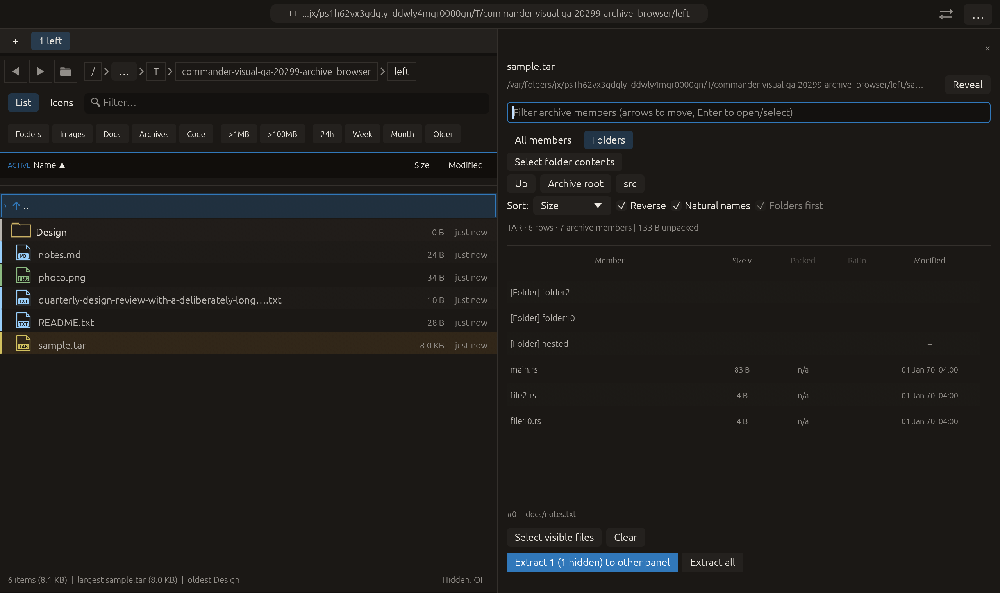

# Natural archive name order — 2026-10-27

Inspired by [Ark's numeric archive collation](https://github.com/KDE/ark/blob/master/part/archivesortfiltermodel.cpp).
No Ark/Dolphin implementation code was copied. Commander's existing directory
comparator moved unchanged into `src/natural_sort.rs` and is reused by archives.
All changes remain local and uncommitted.

## Behavior

**Natural names**, enabled by default for each newly opened archive, puts `file2`
before `file10` and applies equally to synthetic navigation folders. Unchecking
it restores lowercase string comparison. Name reversal works in either mode.
Equal metadata keys break ties by ascending names; original paths, original
archive IDs and listing positions keep final ties deterministic. Duplicate
archive members remain distinct. Folder grouping stays independent of reversal.

ASCII digit runs compare by significant length and bytes, without integer parsing
or overflow. Leading-zero counts break otherwise-equal names only after comparing
their remaining text. Unicode paths retain the existing lowercase display-key
behavior; no Qt locale collation or Ark extension-splitting parity is claimed.
This is a session-only checkbox for the current open archive. No filesystem I/O,
archive rewriting or extraction-ID reassignment is introduced by sorting.

Directory and archive views share the numeric comparator, but keep their existing
key preparation: directories still use their diacritic-aware keys, while archives
use lowercase paths. No performance improvement is asserted.

## Verification

- [Archive tests](archive-tests.log): **62 passed**, including natural/plain/
  reverse names, leading zeros, Unicode, duplicate member IDs, 1000-digit numbers,
  metadata ties, cached-filter invalidation, cursor/selection retention, hidden
  selections and synthetic folder order. Existing ZIP/TAR listing, extraction and
  archive-content search checks passed.
- [Panel tests](panel-tests.log): **242 passed, 1 ignored** after moving the shared
  comparator. Covers the original numeric/Unicode/leading-zero invariants, ordinary
  sort toggles, name ties and directory-list/tree behavior. The ignored test was
  not counted as a pass.
- [Clippy](clippy.log): all targets/features, warnings denied; passed. Formatting
  and whitespace checks passed. Full workspace tests were not repeated for this
  scoped sort change.
- [Harness tests](harness-tests.log): **3 passed**, existing 12-scenario matrix.
- [Native manifest](archive_browser/manifest.json): **14/14 checks**, real macOS
  framebuffer at 1280×760 logical pixels / 2× backing scale. The fixture keeps
  reverse size sorting, with `main.rs` first among real files, `file2.rs` ahead of
  equal-sized `file10.rs`, and synthetic `folder2` ahead of `folder10`. Readiness
  explicitly checks both numeric orders and the checked Natural names state.
  A selection outside the folder remains reported as one hidden member. All
  fake native-effect counters are zero; this capture does not click extraction.
- [Source hashes](source-sha256.txt) identify the inspected implementation files.
  No remote CI execution is implied.

