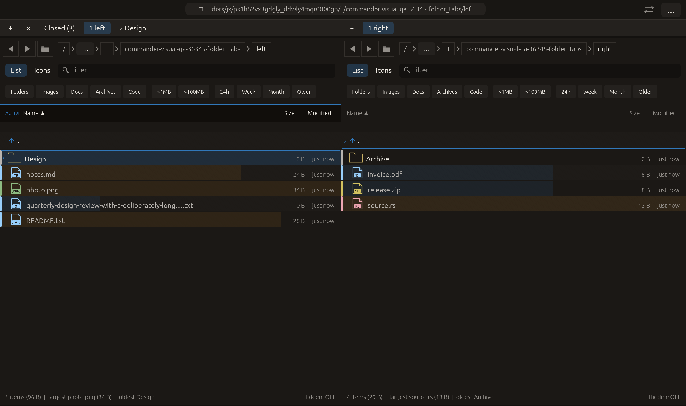

# Open highlighted folders in background tabs — 2026-10-27

Independent adaptation inspired by [Double Commander’s Open Folder in a New
Tab background behavior](https://doublecmd.github.io/doc/en/help.html).
No upstream code or new dependency was added.

## Behavior

**Open highlighted folder in background tab** is a new command-palette entry
and an item in the **+** button's context menu. It captures the highlighted
directory in the addressed pane, inserts a tab immediately after that pane's
current tab and leaves its active index/path unchanged. Existing New tab and
Open highlighted folder in new tab retain their foreground behavior.

The background panel inherits view configuration and starts without loaded rows,
watcher or worker lane. Activation uses the existing lazy-tab path and observes
current directory contents. Creation does not suspend, navigate or reset the
visible panel, its selection, listing, directory history or preview. The strip
continues rendering that panel in the same frame so preview searches are not
retired merely because a tab was inserted. The other pane and Closed history
are unchanged. A new tab revision invalidates command availability and lets
existing session saving include the new tab.

The existing eight-tab limit and operation/modal/delete guards apply. Palette
availability additionally requires a directory under the cursor. The + context
menu targets its own pane, even when it was not previously active. No default
shortcut, multi-folder opening or eager background scan is introduced. Repeated
opens insert directly beside the active tab, so the newest is nearest to it.

## Verification

Focused workspace-tab tests: **19 passed**. Full regression before the final
same-frame rendering/readiness refinements: **2343 passed, 3 ignored**. Final scoped tests: **21 passed**. Final all-targets Clippy with visual-qa and
`-D warnings`, formatting and scoped whitespace checks passed. Logs are retained.

Tests open a real child through the new command, verify unchanged active path,
cursor, selected file, loaded-row count and inherited view settings, inspect the
inactive panel's empty listing/no watcher, then create a new file and confirm
activation observes it. They also cover repeated insertion order on the right
pane, the eight-tab cap and cached command availability, unchanged left pane,
and rejection during a pending rename dialog.

Native folder_tabs first exercises both group-close commands, then focuses
Design, opens the + context menu with raw pointer input and clicks the background
command. Capture requires two tabs, active index zero, the original root still
visible, the new second tab pointing to Design, and unchanged Closed history.
The actual eframe/Glow frame was visually inspected. All **14 manifest checks**
passed, with no native clipboard/opener/trash effects. This extends the existing
20-case CI matrix rather than adding a new scenario.

The initial native run timed out because an editing typo made its readiness
condition demand phase 28 while input stopped at 18 and retained an obsolete
one-tab expectation. That failed log and manifest are retained under rejected/.
The corrected gate requires phase 18 and two tabs; actual pointer-driven behavior
was then captured. No timing threshold was relaxed. No remote CI, commit, push
or performance improvement is claimed.

