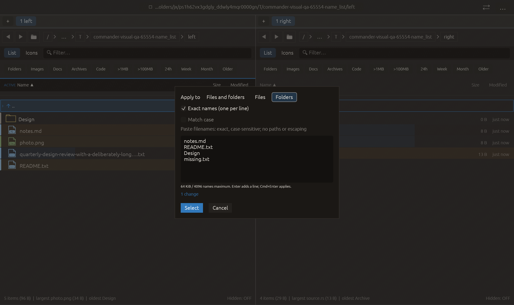

# Case-sensitive selection masks — 2026-10-28

Independent adaptation of [Double Commander cm_MarkPlus casesensitive](https://doublecmd.github.io/doc/en/cmds.html). No upstream source/dependency copied.

Match case is available in Select by mask. Off preserves existing lowercase matching. On preserves original case in patterns and compares the actual original filename and extension, including bare extension shorthand, dotted suffix masks, globs and exclusion terms. Files/folders targeting and subtraction priority remain. The preview and application use the same option; the preview cache key includes it. Each new dialog starts off. Exact names remains independently case-sensitive and disables this checkbox.

Verification:

- Full local suite: **2404 passed, 0 failed, 3 ignored**. New regression checks uppercase JPG versus lowercase jpg for three mask forms, count/application agreement, case-sensitive exclusions, Unicode names and folder-only/file-only targeting. Existing defaults remain covered.
- Added explicit cache-option invalidation/reuse assertions after the full run; the cache test passed again. All-target Clippy with visual-qa and warnings denied passed before this test-only assertion addition. Final formatting/scoped whitespace checks passed.
- Native name_list compatibility scenario passed all manifest checks and zero native side effects. Screenshot inspected: Match case is visible and disabled in Exact names, and the dialog/footer fit. This native scenario does not toggle case-sensitive mask matching; matching behavior is qualified by the core regression and cache test.

No failed checks. Other native scenarios, real file operations and remote CI were not run. No commit or push performed.

