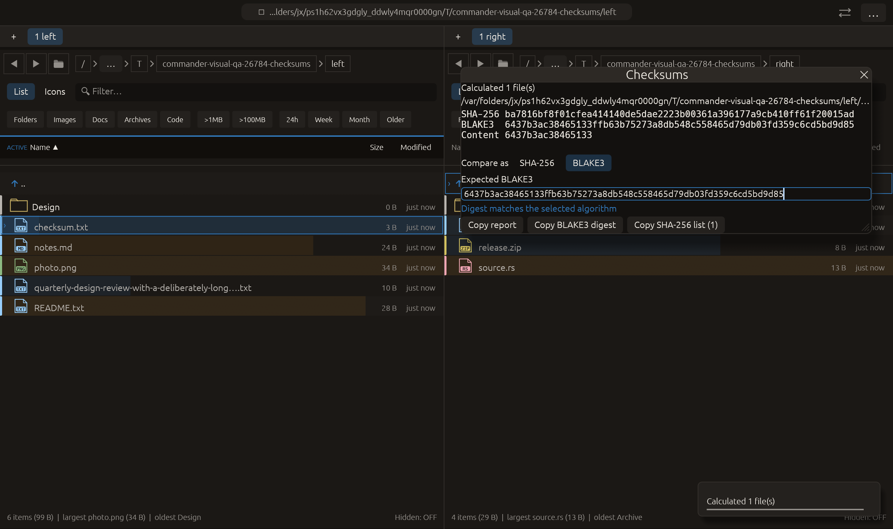

# Explicit checksum comparison algorithms — 2026-10-27

Independent adaptation inspired by [Double Commander’s single-file checksum
verification with an algorithm selector](https://doublecmd.github.io/doc/en/help.html).
No upstream code or new dependency was added.

## Behavior

The Checksums dialog offers **Compare as: SHA-256 / BLAKE3**. Expected digest
comparison uses that explicit selection; both algorithms have 64 hexadecimal
characters, so the algorithm is never inferred from the digest length.
Changing the selector immediately recomputes the comparison against the current
expected text. The text is retained so a SHA-256 match correctly becomes a
BLAKE3 mismatch, rather than retaining an obsolete success indicator.

**Copy SHA-256 digest** / **Copy BLAKE3 digest** copies only the selected algorithm's
64 hexadecimal characters for one eligible file. The report and SHA-256 list
exports remain available separately. Algorithm choice starts at SHA-256 for a
new calculation and is not persisted. An expected digest permits surrounding
whitespace and uppercase hex; tagged checksums or lists are not parsed here.

The common single_digest gate requires exactly one row, a noncancelled report,
no row error/skip and a valid digest for the chosen algorithm. Missing, malformed,
failed, skipped, cancelled and multi-file results cannot be compared or copied
as one digest. It does not substitute the other algorithm when one is missing.

Calculation still uses one fresh identity-checked, cancellable read to compute
both hashes. Switching algorithms or copying a completed digest does not read
the file again; results describe that calculation, not future file contents.
No BLAKE3 checksum-list export, checksum-file parser or authenticity proof is
introduced.

## Verification

- Full current regression: **2337 passed, 3 ignored**.
- Checksum-filtered tests: **17 passed**.
- All-targets Clippy with visual-qa and `-D warnings`: passed.
- Formatting and scoped whitespace checks: passed.

The new tests calculate a real abc file, check the known BLAKE3 vector, compare
both algorithms against their own and the other digest, check uppercase/trimmed
input, and reject invalid/unavailable reports. They also exercise the same
single_digest gate used by the copy button. Existing path identity, cancellation,
SHA-256 vectors and checksum-list escaping tests remain passing.

The native checksums scenario uses pointer and text input: paste the known
SHA-256 for abc and require a SHA-256 match; select BLAKE3 and require a mismatch;
replace expected text with the known BLAKE3 digest and require a BLAKE3 match.
The final screenshot was visually inspected. All native manifest checks passed.
The copy button is visible; this scenario does not click it or write clipboard
contents. Its payload is verified by the pure common-gate tests. The scenario
stays in the existing 20-case CI matrix. No remote CI, push, commit or performance
gain is claimed.

