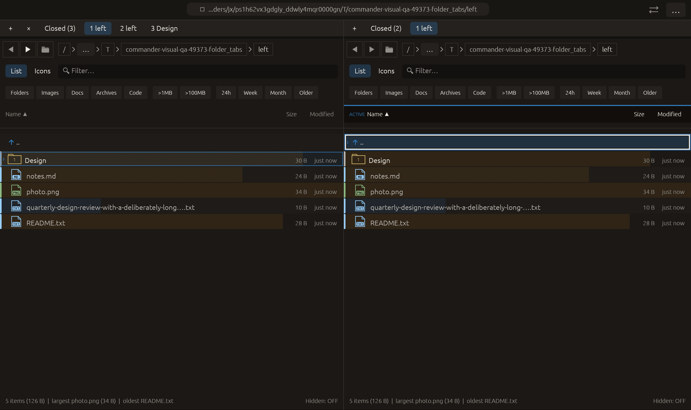

# Close folder tabs to the left — 2026-10-27

Independent adaptation of [Dolphin’s close-tabs-to-left/right actions](https://kde.org/announcements/changelogs/gear/26.08.0/). This fills the missing left-hand counterpart to Commander’s existing right/other group actions. No upstream source/dependency copied.

The context menu acts relative to the pointed tab, including an inactive tab. It closes only the prefix before it. If the current visible tab survives, it remains visible; if it belongs to the removed prefix, the pointed tab becomes visible first. At least the pointed tab survives. Descending removal preserves original positions in the bounded recently-closed history; reopening restores original order. Invalid indices, the first tab and pending modal ownership prevent changes. Existing menu group actions focus their pane; the workspace operation itself preserves global focus.

Verification:

- Focused matrix passed: both panes, three active positions and three anchor positions, survivor bindings/active index, other-pane count, closed counts and LIFO restoration of original order; invalid indices checked. The existing rename-modal guard test now checks close-left too.
- Full local suite: **2391 passed, 0 failed, 3 ignored**.
- All-target Clippy with visual-qa and warnings denied, formatting and scoped whitespace checks passed.
- Native folder_tabs extends the existing sequence through its move-tab operation, opens the menu on the right inactive second tab and clicks Close folder tabs to the left. The visible first tab is closed, the pointed folder becomes the sole right tab, right pane receives focus and closed history gains the removed folder. Left-pane tabs remain as before. All manifest checks passed, zero native side effects; screenshot inspected.
- Other native scenarios and remote CI were not rerun. The existing native Root navigation emits missing /.VolumeIcon.icns warnings; capture succeeds and logs are retained.

No failed checks occurred. No commit or push performed.

