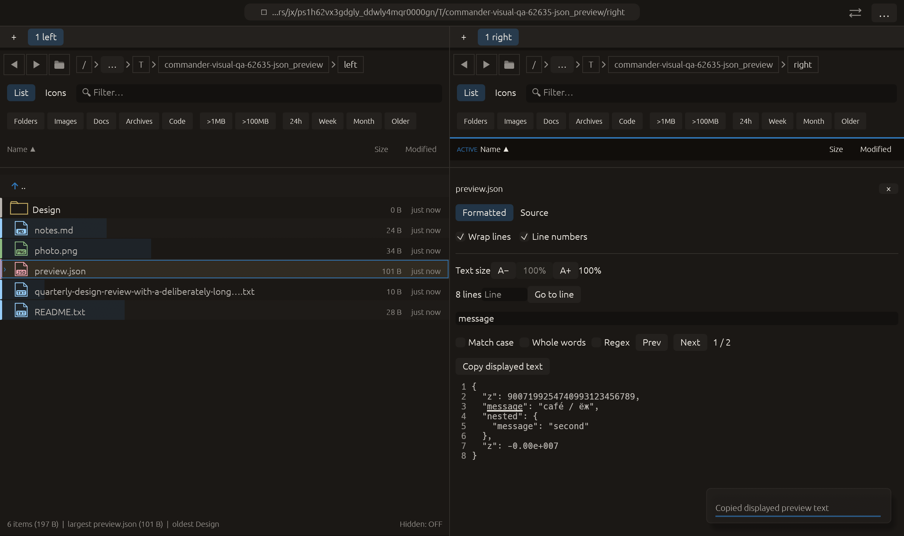

# Copy the currently displayed preview text — 2026-10-27

Independent usability adaptation of the [text-copy facilities in Double
Commander’s built-in viewer](https://doublecmd.github.io/doc/en/viewer.html),
and Commander’s existing PDF page-text copying. No upstream code or dependency
was added.

## Behavior

Text previews now offer **Copy displayed text**. It copies the entire current
galley text, including parts outside the viewport, without requiring a selection.
Formatted JSON copies its indented text; Source copies the loaded source.
Markdown/HTML copy their displayed static text. Syntax colors, search emphasis,
line-number gutter, toolbar labels and soft wrapping do not become payload text.
Existing literal controls/newlines in that text are retained. Empty text disables
the button; loading previews have no copy action.

The action covers only loaded/rendered preview text, not the unread rest of a
large file. Existing document formatter limits and any generated text remain
part of the displayed representation. This is a text-copy convenience, not a
byte-preserving file export or rich-text clipboard format. CSV/TSV Table mode
returns before this text action; Source mode provides it. PDF keeps its existing
separate Copy page text control.

Rendering emits an owned text payload through PanelRenderOutcome. After rendering
both panes, App sends that payload through the existing ClipboardPort/write_clipboard
boundary, retaining its normal success/submitted/error feedback. The renderer does
not write the pasteboard directly. No clipboard read or filesystem mutation was
added, and panes do not change their active folder or selection to copy text.

## Verification

- New pointer-driven egui copy test: passed across JSON formatted/source,
  Markdown, plain Unicode/control text and empty text.
- Full regression before extracting the equivalent effect-policy helper and
  adding its test: **2356 passed, 3 ignored**.
- Final QA tests after that refinement: **4 passed**.
- Final all-targets Clippy with visual-qa and `-D warnings`: passed.
- Formatting and scoped whitespace checks: passed.

The renderer test clicks the real button and verifies the deferred payload equals
the displayed galley, including the exact JSON pretty form and unchanged raw
source. Markdown markers are absent from the copied rendered text. It verifies
that no direct egui CopyText platform command is emitted. Empty text produces no
payload. The effect-policy test rejects zero/two clipboard calls or any opener
call in the copy scenario and rejects clipboard calls in every other scenario.

Native json_preview uses raw pointer input to switch Source → Formatted, then
clicks Copy displayed text. Capture requires exactly one recording ClipboardPort
write whose stored payload equals the current formatter text, alongside preserved
JSON tokens and both find results. The actual macOS eframe/Glow frame was visually
inspected. All **14 manifest checks** passed. The manifest records clipboard=1,
all other effects zero; the payload equality is an enforced readiness gate.
The real pasteboard was not accessed by the recording fake.

This extends the existing json_preview case in the 22-case CI/README matrix.
Every other scenario still requires zero native-effect calls. No remote CI,
commit, push or performance gain is claimed.

