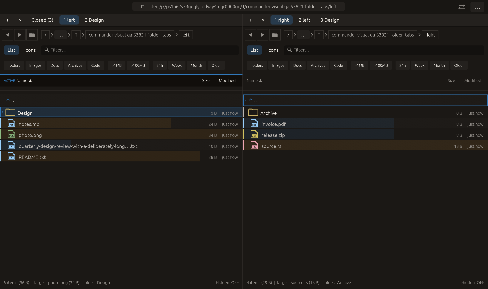

# Copy folder-tab groups to the opposite pane — 2026-10-27

Independent adaptation inspired by [Double Commander’s
cm_CopyAllTabsToOpposite](https://doublecmd.github.io/doc/en/cmds.html).
No upstream code or dependency was added.

## Behavior

**Copy all folder tabs to other pane** is available in the command palette and
a folder tab's context menu. The menu's pane is the source, regardless of which
tab's menu was opened. Every source tab's path and ViewConfig is copied, in strip
order, immediately after the destination pane's active tab. Its existing prefix
and suffix remain in order. Both active tab indices and currently displayed
folders remain unchanged. Identical paths are copied too; deduplication remains
an explicit separate command.

Copying requires enough destination capacity for the entire group within the
eight-tab limit. An insufficient-capacity operation changes neither pane,
closed history nor revision; no partial group is copied. The palette and menu
explain that capacity requirement. The existing pending-operation/delete/modal
gate is enforced again in the workspace before insertion.

New panels start lazily from saved paths/view settings, without loaded rows or
watchers. Selection, cursor and directory-history runtime state are not cloned.
Activating a copy uses normal lazy activation and reads current contents. Source
and existing destination panels retain their selection/listing/preview objects;
no visible panel is suspended or briefly skipped in rendering. Closed history is
unchanged and the workspace revision increments once per successful group copy,
invalidating cached command availability and participating in existing session
saving. No file contents are copied or moved. No new shortcut, tab-set file
format or across-both-panes mode is introduced.

## Verification

- Focused copy-tab tests: **2 passed**.
- Full current regression: **2351 passed, 3 ignored**.
- All-targets Clippy with visual-qa and `-D warnings`: passed.
- Formatting and scoped whitespace checks: passed.

The capacity/order matrix covers **128 combinations** of source pane and source/
destination counts 1–8. It checks all-or-nothing capacity, palette availability,
exact path/ViewConfig order, preserved active indices/source snapshot, untouched
Closed histories, one revision update, and unloaded/unwatched new panels. A
command integration test preserves real selections in both visible folders,
creates a later file and confirms that activating the copied tab observes it
with a fresh selection. The existing pending-rename modal test rejects copying.

Native folder_tabs first exercises group closing and background opening, then
uses actual pointer input to open the context menu of the inactive Design tab
and copy the entire two-tab source group. Capture requires two source tabs and
three destination tabs, unchanged active index zero in each pane, both original
roots still visible, and copied root/Design paths in order on the right. The
actual macOS eframe/Glow frame was visually inspected. All **14 manifest checks**
passed with no native clipboard/opener/trash effects. This extends the existing
folder_tabs case in the 21-case CI matrix. No remote CI, commit, push or
performance gain is claimed.

