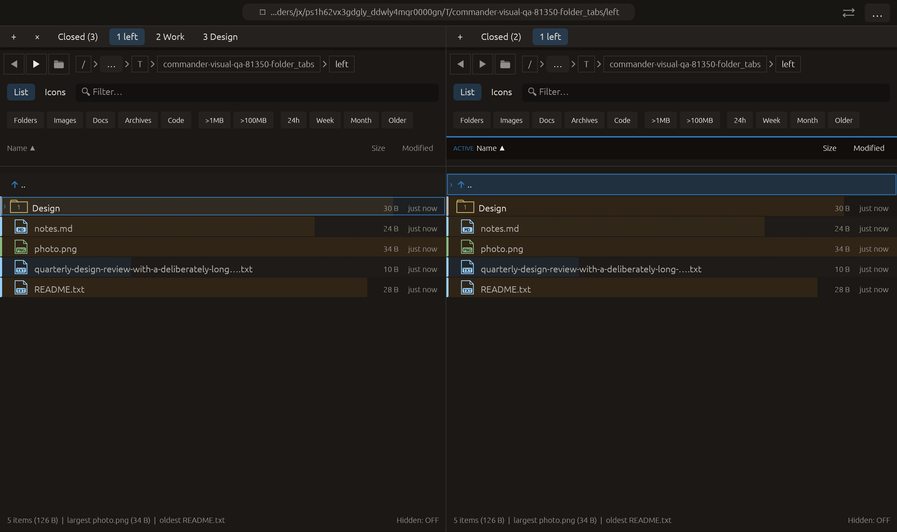

# Custom folder-tab titles — 2026-10-28

Independent adaptation of [Double Commander Rename Tab](https://doublecmd.github.io/doc/en/help.html). No upstream code or new dependency copied.

Each tab’s context menu now contains Tab title, Save title and Use folder name. Empty/whitespace-only titles restore the folder-derived label. Titles are trimmed, limited to 64 Unicode scalars and reject control characters. The tab label uses the custom title; its tooltip and accessibility label retain the full folder path. Editing a background tab changes only presentation metadata, preserving pane focus, active folders and runtime panel state.

Titles live on the tab’s owned panel and are included in SavedTab session data. They survive directory navigation, duplicate/copy/move operations, recently-closed recovery and saved-tab restoration. Legacy session JSON defaults to automatic labels. Invalid title metadata is discarded without dropping the path/tab. Active saved titles are only restored when their saved path matches the actual visible path, respecting launch-path overrides.

The context menu now closes on outside clicks or explicit actions, allowing text entry. Pane-body pointer activation is suppressed while a popup is open, preventing background editing from activating the pane underneath it.

Verification:

- Final full local suite: **2415 passed, 0 failed, 3 ignored**. New lifecycle regression runs both pane directions through background naming, duplication, group copying, navigation, cross-pane movement, close/reopen, JSON round-trip and restoration of active/inactive titles, then clears the custom name. Validation tests cover old JSON, invalid metadata types/control characters/overlong strings, no-op/revision preservation and path overrides. Existing rename-modal guard now rejects title changes too.
- Final all-target Clippy with visual-qa and warnings denied, formatting and scoped whitespace checks passed.
- Native folder_tabs preserves the previous 55-phase sequence, opens the inactive left tab’s menu, focuses its title field, types Work and clicks Save title. Capture requires the actual persisted snapshot title Work while both active indices, folder paths, closed histories and right-pane focus remain as before. All **14 checks** passed with zero native effects. Screenshot inspected: Work appears on the second left tab, right pane stays active.
- Rejected evidence retained: Clippy flagged a redundant borrow after switching the label from Cow to str; corrected. Two native attempts revealed default context-menu close-on-click behavior preventing text editing and activating the underlying pane. Diagnosed from actual final phase/title/focus, fixed popup close behavior and pointer ownership, then reran the full suite, Clippy and native capture successfully.

Session serialization/restoration is tested; a real desktop process restart was not performed. Other native scenarios and remote CI were not rerun. Existing Root-navigation /.VolumeIcon.icns warnings remain in native logs. No commit or push performed.

