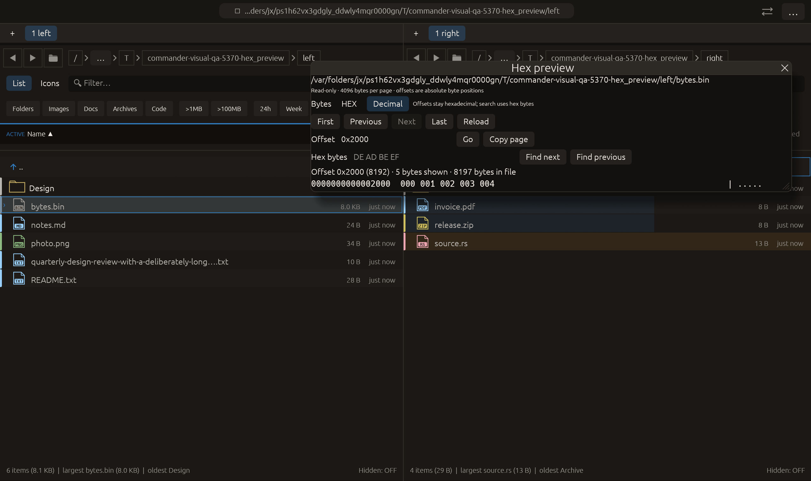

# Decimal byte preview — 2026-10-27

Independent adaptation of [Double Commander’s Show as Dec viewer mode](https://doublecmd.github.io/doc/en/viewer.html). No upstream code or dependency was copied.

## Behavior

The paged binary viewer now offers HEX / Decimal. Decimal renders each byte as a three-digit value from 000 to 255 while retaining the same printable-ASCII column and 16-byte row layout. Missing positions in short rows are padded so ASCII columns stay aligned. Absolute row offsets remain hexadecimal; the toolbar also shows decimal offset context. Search still takes exact hexadecimal byte patterns, explicitly stated beside the mode controls and search field.

The representation belongs to the viewer instance, defaults to HEX for a new viewer and stays selected across page loads/search/reload. Switching mode reuses the existing loaded page without issuing I/O, changing the offset, modifying bytes or restarting a search. Copy page returns the selected byte representation, offsets and ASCII through the existing explicit clipboard path. Existing 4 KiB page bounds, file-identity checks, cancellation and streaming search are retained.

## Verification

- Hex-preview tests: **15 passed**. New tests reconstruct all 256 byte values from decimal rows, compare ASCII with HEX, verify short-row alignment/absolute offsets and unchanged source bytes. A pointer-driven egui test clicks Decimal then Copy page, verifies the actual returned clipboard request text, unchanged offset and no queued additional read; it also checks new-viewer HEX default. The test does not touch the system clipboard.
- Full visual-qa regression: **2378 passed, 3 ignored**.
- All-targets Clippy with visual-qa and warnings denied, formatting and scoped whitespace checks: passed.

Native macOS eframe hex_preview retains its paging/absolute-offset interactions and then clicks Decimal at offset 8192. Capture requires the loaded final page and selected decimal mode. The frame was visually inspected: Decimal is selected, row offset 0000000000002000 remains hexadecimal, and the five remaining bytes display as 000 001 002 003 004. All **14 manifest checks passed**, with zero recording native effects. Native QA does not press Copy page; the pointer-driven unit test covers its returned payload. The existing 22-scenario matrix is unchanged; other native scenarios and remote CI were not rerun.

No failed check occurred for this change. No commit or push was requested or performed.

