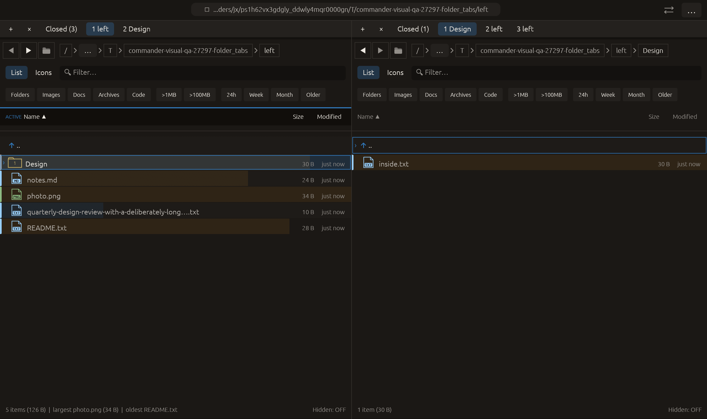

# Duplicate a pointed folder tab — 2026-10-27

Independent adaptation inspired by [Krusader’s Duplicate Current Tab action](https://docs.kde.org/trunk_kf6/en/krusader/krusader/folder-tabs.html). Commander’s context action targets the pointed tab, including an inactive one, and creates the copy in the background. No upstream code or dependency was copied.

## Behavior

Duplicate this folder tab inserts a copy immediately beside its source. It copies the exact directory and ViewConfig of that tab rather than those of the currently visible panel. The current folder, live cursor/filter/selection/preview and globally active pane remain unchanged. Inserting before the live slot adjusts its index while retaining the same live panel.

The copy is a lazy fresh panel: its entries/watcher are not loaded until activation, and it starts with fresh transient selection/filter/history rather than cloning all runtime state. Existing Closed history is retained. Copies count toward the eight-tab limit; invalid indices, full panes and modal/operation guards reject insertion without partial changes. The menu disables the action at capacity and explains the limit.

## Verification

- Two focused tests passed. They cover both pane sides and source slots before/at/after the active slot, distinct source view settings, exact tab order/index adjustment, unchanged live preview/filter/cursor/selection/focus, lazy empty entries/no watcher/fresh selection, and atomic invalid-index/capacity rejection.
- The existing pending-modal test now checks duplicate rejection as well.
- Full visual-qa regression: **2395 passed, 3 ignored**, including the prior middle-close pointer-focus correction.
- All-targets Clippy with visual-qa and warnings denied, formatting and scoped whitespace checks passed.

Native macOS eframe folder_tabs retains prior tab operations and middle-close, then opens the right inactive tab’s context menu and clicks Duplicate this folder tab. The pointed tab is left while the visible right folder is Design, so capture checks that the duplicate is left, not Design. It also requires three right tabs, unchanged current folders/left focus and retained Closed history. The frame was visually inspected: right has two background left tabs while Design remains active and the left pane stays ACTIVE. All **14 manifest checks passed**, with zero recording native effects. The 22-scenario matrix is unchanged; other native scenarios and remote CI were not rerun.

No failed validation run occurred for this change. No commit or push was requested or performed.

