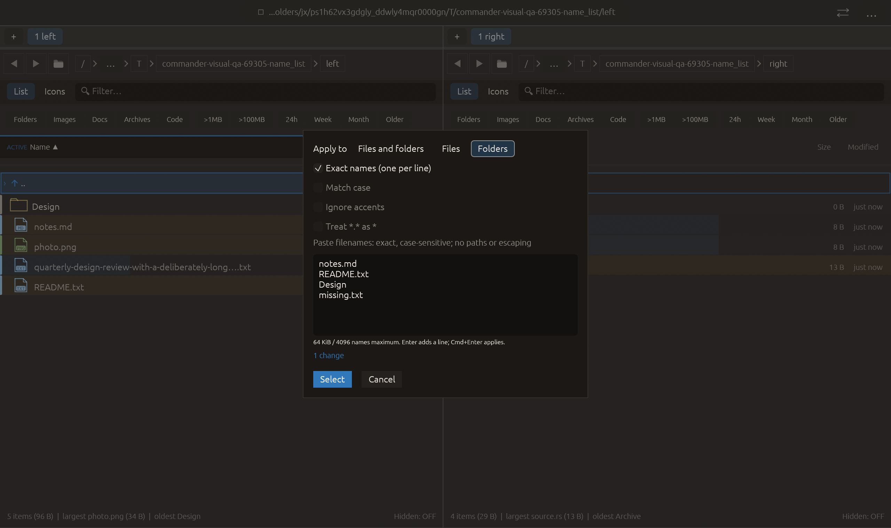

# Include extensionless names with *.* — 2026-10-28

Independent adaptation of the explicit *.* behavior documented in [Double Commander’s marking settings](https://doublecmd.github.io/doc/en/configuration.html). No upstream source or dependency copied.

Treat *.* as * makes an exact *.* term match every name, including extensionless ones. It also applies to subtracting terms, so !*.* clears matching selected entries in the current target/view. Other terms keep their existing semantics; this is a specific compatibility option, not a full implementation of Windows/DOS wildcard rules. It starts off for every dialog, is disabled in Exact names and composes with case/accent options. Preview and application share the option; the cache key includes it. Existing APIs retain their default behavior through wrappers.

Verification:

- Full local suite: **2406 passed, 0 failed, 3 ignored**. New regression covers Both/Files/Folders targets, unchanged default *.* behavior, count/application/idempotence, subtracting *.*, unchanged *.txt semantics and accent-folded exclusions. Cache coverage verifies option invalidation/reuse.
- All-target Clippy with visual-qa and warnings denied, formatting and scoped whitespace checks passed.
- Native name_list compatibility scenario passed all **16 checks** with zero native effects. Screenshot inspected: compatibility control is disabled in Exact names and the dialog/footer fit. Native scenario does not enable extensionless masks; actual semantics are qualified by the core regression.

Other native scenarios, real file operations and remote CI were not rerun. No failed checks, commit or push.

