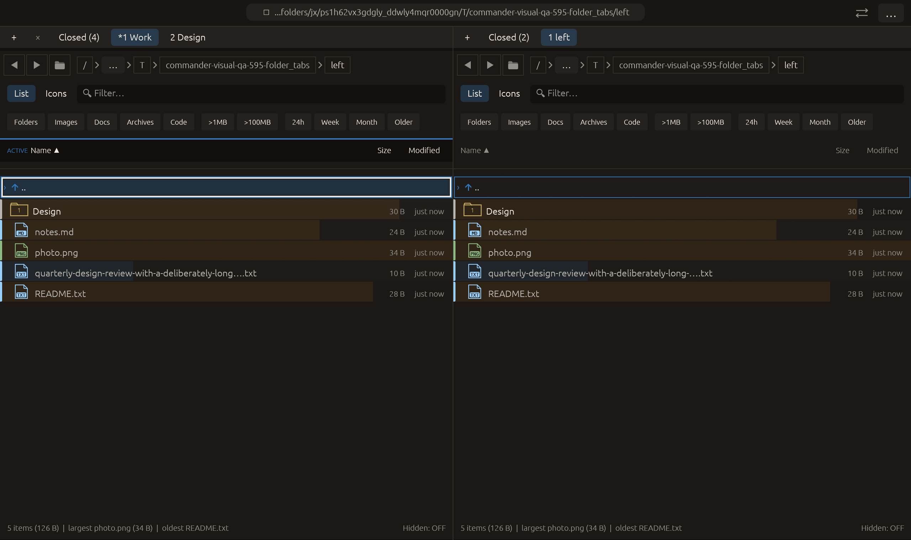

# Group tab closing from the palette — 2026-10-28

Independent adaptation of [Double Commander CloseAllTabs](https://doublecmd.github.io/doc/en/cmds.html) and its protected-tab exclusions. No upstream code copied. Three palette actions close other tabs, tabs to the left, or tabs to the right of the active tab in the focused pane. Cross-pane parameters and forced protected closing are not claimed.

Existing group-closing operations preserve the anchor and protected peers, retaining closed runtime panels and positions in the bounded history. A shared SavedTabs closable_sides calculation drives palette capabilities and tab-menu availability. All-protected/no-peer groups now disable the menu entries as well. Pending-operation predicates and runtime modal guards apply.

Validation:

- Full local suite: **2423 passed, 0 failed, 3 ignored**. New regression runs both panes × 16 protection masks × four active positions × three group commands (384 cases). It compares capability counts with actual survivors, preserves the current filter/focus and other pane, checks no-op revision behavior, restores original ordering and per-tab filters, then verifies modal execution denial.
- All-target Clippy with visual-qa and warnings denied passed. Formatting and scoped whitespace checks passed. No rejected run for this feature.
- Native folder_tabs compatibility run exited successfully; **14/14 checks passed**, all recording native-effect counters zero. Existing scenario exercises context-menu group closure, title/protection and deduplication; it does not invoke the three new palette entries or the all-protected disabled-menu state. Screenshot inspected. Existing launch-path and /.VolumeIcon.icns warnings retained.

The palette dispatcher/capability paths and protected empty-group semantics are tested in the regression; no native keyboard/palette interaction or real process restart is claimed. Other native scenarios and remote CI were not rerun.

 No commit or push.
