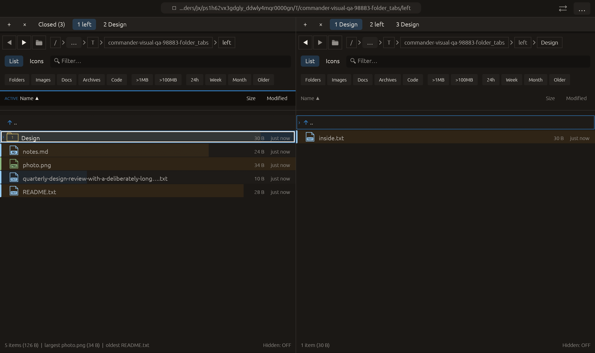

# Home and root navigation — 2026-10-27

Independent implementation inspired by [Double Commander’s ChangeDirToHome / ChangeDirToRoot commands](https://doublecmd.github.io/doc/en/cmds.html). No upstream code or dependency was copied.

## Behavior

The palette now provides Go to home folder (Cmd+Shift+H; Ctrl+Shift+H on platforms whose command modifier is Ctrl) and Go to disk root. Plain Cmd+H continues toggling hidden files. Home uses the existing dirs dependency; a missing or nonabsolute home yields a notice instead of silently going elsewhere. Root is the lexical filesystem root of the current absolute path: / on Unix or the current drive/share root on Windows. It is not a mount-point detector for /Volumes devices.

Both commands use the active tab's normal remembered navigation and Back/Forward trail. The opposite pane, navigation-lock setting and inactive tabs are retained. Navigating back restores the earlier directory's cursor/filter/selection through existing panel behavior. Repeating a command while already at its target does not reload or discard the current filters. An active preview closes to show the directory listing. An open file-operation confirmation blocks both palette availability and workspace execution. No writes, transfers or new tabs are involved.

## Verification

- Full visual-qa regression: **2375 passed, 3 ignored**.
- Three new tests cover both directions, home and root destinations, restoration of source filters/cursor/selection, unchanged opposite pane under navigation lock, full eight-tab groups, confirmation gating and actual egui modifier/key routing. The existing shortcut/catalog consistency tests also passed.
- All-targets Clippy with visual-qa and warnings denied: passed.
- Following the native harness ordering refinement, all four visual-qa contract/matrix tests passed. Formatting and scoped whitespace checks passed.

Native macOS eframe folder_tabs retains the previous tab/menu/opposite-folder interactions. It then sends Cmd+Shift+H through raw egui modifier/key events and waits for the actual home path. It returns via workspace JumpBack, executes GoRoot, waits for the actual root path, and returns again. Capture requires that sequence to finish with the original fixture path and the expected opposite pane/tab groups. Home/root directory contents are not saved in the screenshot: the inspected frame shows only temporary fixtures after returning. Root and Back are dispatched as workspace commands in this native scenario; the home shortcut exercises actual keyboard routing. All **14 manifest checks passed**, with zero recording native effects. The 22-scenario matrix is unchanged; other native scenarios, Windows drive behavior and remote CI were not rerun.

No failed validation run occurred for this change. No commit or push was requested or performed.

