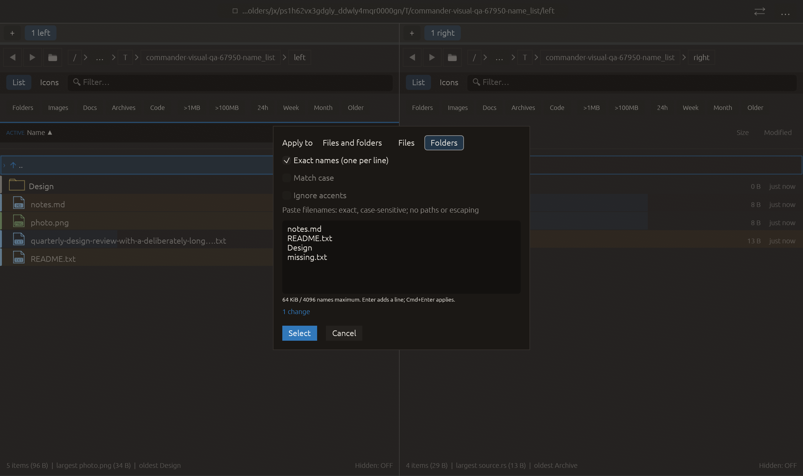

# Ignore accents in selection masks — 2026-10-28

Independent adaptation of [Double Commander cm_MarkPlus ignoreaccents](https://doublecmd.github.io/doc/en/cmds.html). Uses the existing unicode-normalization dependency; no upstream code/new dependency copied.

Ignore accents folds comparison text with canonical decomposition and combining-mark removal, and expands a defined set of common Latin ligatures: œ/Œ, æ/Æ, ß/ẞ, ff, fi, fl, ffi, ffl. This affects both mask terms and compared names/extensions, including exclusions. Match case remains independent. Examples: *cafe* matches café and decomposed café; *coeur* matches cœur. Matching is performed on folded strings, so wildcard lengths apply to that representation. This is not a general transliterator or a promise of Double Commander’s entire mapping table. It does not rename files.

The option starts off with each dialog, is disabled in Exact names and is included in the preview count cache key. Preview/application use the same folding option. Default paths retain their old matching behavior without the extra folding allocations.

Verification:

- Full local suite: **2405 passed, 0 failed, 3 ignored**. New regression covers composed/decomposed accents, accented patterns, common ligatures, sharp-s expansion, matching counts/application/idempotence, case-sensitive exclusions and file/folder targeting. Strict legacy matching remains accent-sensitive. Combining-mark-only terms become empty and are discarded. Cache test explicitly verifies option invalidation and reuse.
- All-target Clippy with visual-qa and warnings denied, formatting and scoped whitespace checks passed.
- Native name_list compatibility scenario passed all **16 checks** with zero native effects. Screenshot inspected: both comparison options are disabled in Exact names, and the dialog/footer fit. This scenario does not exercise enabling accent-insensitive masks; the core regression and cache test qualify matching behavior.

Other native scenarios and remote CI were not rerun. No failed checks, real-file operations, commit or push.

