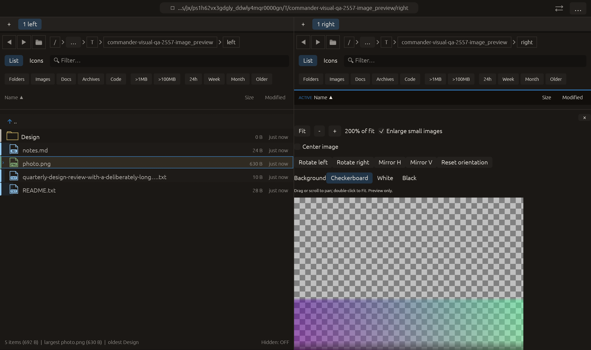

# Image preview alignment — 2026-10-27

Independent adaptation of [Double Commander’s Center image option](https://doublecmd.github.io/doc/en/viewer.html). No upstream code or dependency was copied.

## Behavior

Center image defaults on, preserving the previous placement. Disabling it anchors the displayed image at the upper-left of its scroll canvas. Its effect is visible along axes where the image is smaller than the available preview. On larger axes the image and canvas already start together; normal scrolling remains available.

Alignment does not alter display size, Fit-relative zoom, decoded source pixels, orientation, alpha background or the optional small-image enlargement. Changing alignment resets pan so the new anchor is visible. Fit and double-click retain alignment. The choice belongs to the current pane/path view; another pane is independent and a new path starts centered. It is a session-only preview control, not an image edit or a persisted global preference.

## Verification

- Image-preview module tests: **12 passed**. The new pointer-driven egui test captures actual textured mesh bounds before/after disabling Center image, verifies unchanged size and a left/up shift, and checks retained zoom/orientation/background plus pane and new-path defaults.
- Full visual-qa regression: **2376 passed, 3 ignored**.
- All-targets Clippy with visual-qa and warnings denied, formatting and scoped whitespace checks: passed.

Native macOS eframe image_preview retains its prior rotation/mirroring/background/enlargement interactions, then clicks Center image off. Capture requires the new state alongside the loaded texture, 200% Fit-relative zoom and prior orientation/background choices. The frame was visually inspected: the unchecked control is visible and the image starts at the preview’s left edge; its oversized vertical extent remains pannable. All **14 manifest checks passed**, with zero recording native effects. The separate small-image mesh test verifies both axes when neither dimension fills the canvas. The 22-scenario matrix is unchanged; other native scenarios and remote CI were not rerun.

No failed check occurred for this change. No commit or push was requested or performed.

