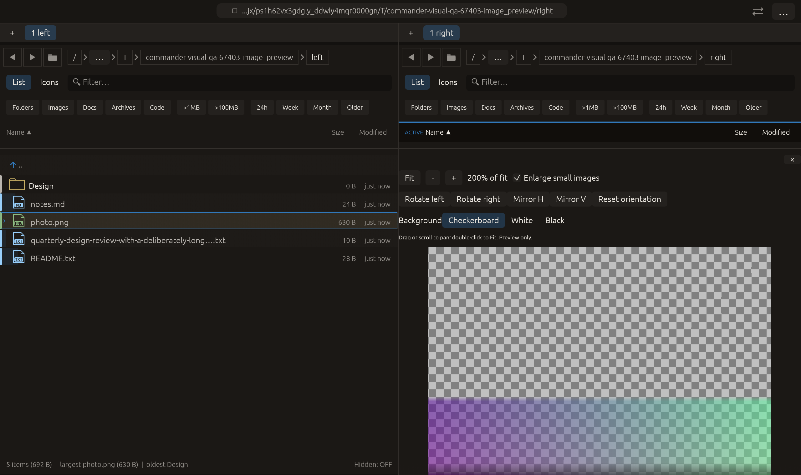

# Enlarge small images in preview — 2026-10-27

Independent adaptation inspired by [Double Commander’s Stretch / Stretch only
large options](https://doublecmd.github.io/doc/en/viewer.html).
No upstream code or dependency was added.

## Behavior

**Enlarge small images** allows Fit to fill the available preview area even when
the decoded texture is smaller, while preserving aspect ratio. It defaults off,
retaining the previous no-upscale Fit behavior. Larger images still scale down
in the same way with either value. Plus/minus remains 25–800% relative to the
chosen Fit baseline; enabling this option does not change that zoom multiplier.

The choice is stored in the existing per-pane/per-path view state. A new path
starts with enlargement off; the other pane is independent. Fit and double-click
reset zoom/position while retaining this sizing choice, orientation and background.
Changing the option resets pan to the origin for the resized content. Rotation,
mirroring and checkerboard/white/black backgrounds compose with the sizing mode.

Only display geometry changes. It does not resample/save source files or invent
source detail; enlargement can look blurry, as the control tooltip explains.
The existing bounded texture decode, 4096-pixel target and memory limits still
apply. Sizing is based on the decoded texture and UI scale, not a new guarantee
of original-file pixel-for-pixel display. No persisted preference or new hotkey
was added.

## Verification

- Focused image-preview tests: **13 passed**.
- Full current regression: **2359 passed, 3 ignored**.
- All-targets Clippy with visual-qa and `-D warnings`: passed.
- Formatting and scoped whitespace checks: passed.

New tests check wide/tall small-image geometry, unchanged large-image Fit,
relative zoom and aspect ratio. A pointer-driven egui test clicks the checkbox
and verifies that the actual textured mesh grows from 32×16 while retaining 2:1
aspect, then checks new-file reset and pane independence. Existing drag/pan,
double-click reset, all eight orientations and transparency tests remain passing.

The initial compile missed the new field in the visual seed initializer. That
rejected log is retained under rejected/; the initializer was completed before
all passing checks and native verification.

Native image_preview now uses a **96×72** transparent fixture (previously 960×720)
to exercise actual small-image enlargement. Raw pointer input rotates, mirrors,
selects black then checkerboard, and enables enlargement. Capture requires the
new option, 200% relative zoom and the expected orientation/background with a
loaded texture. The actual macOS eframe/Glow frame was visually inspected. At
200% the image is intentionally larger than the viewport and can be panned.
All **14 manifest checks** passed, with zero native clipboard/opener/trash effects.
This extends the existing image_preview case in the 22-case matrix. No remote CI,
commit, push, image-quality gain or performance gain is claimed.

