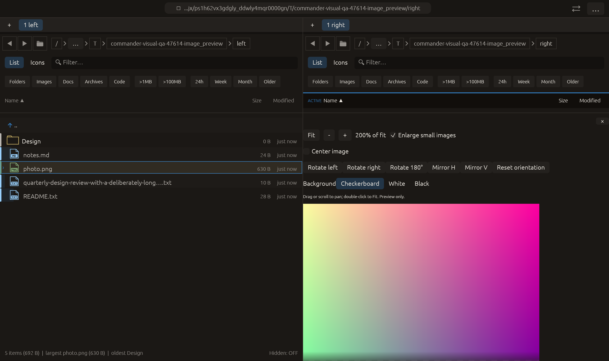

# Image preview half-turn — 2026-10-27

Independent adaptation of the +180 image rotation action documented in [Double Commander’s viewer](https://doublecmd.github.io/doc/en/viewer.html). No upstream code/dependency copied.

Rotate 180° applies a half-turn in display space, composing with existing rotation/mirror state. It retains zoom, alignment, enlargement and transparency background. Extent is unchanged by the half-turn. Like existing orientation actions it resets pan and reuses the preview texture; source pixels/files are not transformed.

Verification:

- Full local suite: **2390 passed, 0 failed, 3 ignored**. New test compares a half-turn with two right turns and verifies two half-turns restore the original, for all eight mirrored/rotated states; dimensions remain unchanged. This full run also includes the corrected preview-clear pointer test from the preceding feature.
- All-target Clippy with visual-qa and warnings denied passed before the final native-script bound correction. Final formatting/scoped whitespace checks passed.
- Native image_preview retains previous rotation/mirror/background/enlarge/center interactions and clicks Rotate 180°. Capture requires actual corners [2,1,0,3], retaining disabled centering, enabled enlargement and checkerboard. All manifest checks passed with zero native side effects; screenshot inspected.
- First native attempt timed out because the event loop still stopped at phase 18 while capture expected phase 21. Corrected the event-loop bound and reran successfully; rejected log retained. Production code unchanged by this repair.

The other native scenarios and remote CI were not rerun. No commit or push performed.

