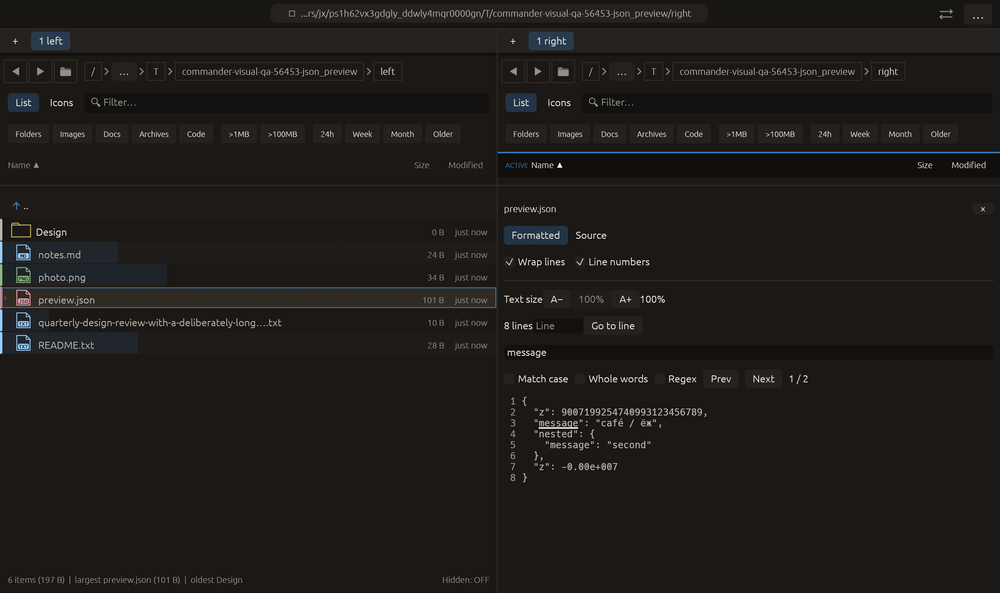

# Whitespace-preserving formatted JSON preview — 2026-10-27

Independent adaptation inspired by [ranger’s JSON preview in scope.sh](https://github.com/ranger/ranger/blob/master/ranger/data/scope.sh),
which offers JSON formatting through external tools. Commander implements its
own bounded formatter with existing serde_json support, no subprocess or new
dependency. No upstream code was copied.

## Behavior

.json (case-insensitive) previews offer **Formatted / Source**. Formatting changes
only whitespace outside strings: indentation, line breaks and separator spaces.
It retains original field order, duplicate keys, integer/float lexemes (including
large integers and exponents), string escapes and Unicode content. It never
round-trips through serde_json::Value, deduplicates keys or converts numbers.
Source shows the originally loaded text. No source file is modified.

Loaded JSON syntax is checked with serde_json's ignored-value deserializer and
an end-of-input check before formatting. The formatter then tracks quoted strings
and escapes while handling structural punctuation. It accepts JSON scalars and
empty containers too; JSONL, comments and multiple adjacent values are not a new
supported format. This is readable whitespace formatting, not canonicalization,
a schema validator, JSON tree editor or syntax-color implementation.

Limits: **256 KiB loaded input**, **128 nested containers**, and **1 MiB formatted
output**. Invalid, incomplete or over-budget input keeps the loaded source and
displays an explanation. The wording refers to loaded text because a bounded
file loader may have supplied a prefix. It does not declare the entire file
invalid based only on that prefix. Expansion stops at the output budget rather
than allocating an arbitrarily large indented document.

Formatting is cached per pane by the owned source Arc, including failures. Stable
repaints reuse the formatted Arc; a new source allocation invalidates it. Plain
monospace layout retains line numbers/Go to line, wrap, text size and find. Search
operates on the displayed text, so its existing regex byte limit also applies to
expanded output. The shared per-pane Source preference follows existing document
preview behavior; no new persistent preference is introduced.

## Verification

- Corrected JSON-filter tests: **7 passed** (including the new formatter/UI tests).
- Full current regression: **2355 passed, 3 ignored**.
- All-targets Clippy with visual-qa and `-D warnings`: passed.
- Formatting and scoped whitespace checks: passed.

New tests cover duplicate-key order, large integers, exponent/negative-zero
spellings, escaped quotes/backslashes/Unicode, empty containers/scalars, malformed
and trailing data, depth/input/output caps, cache reuse and source fallback.
A real egui render test switches Formatted → Source → Formatted, verifies the
actual galley content and retains both search matches.

The initial focused run contained a malformed escaped-quote fixture and correctly
rejected it. The fixture was corrected without changing production formatting to
accept invalid JSON. Its original failed log remains under rejected/.

Native **json_preview** adds a case to the now **22-case** CI/README matrix. It
opens the actual JSON fixture, seeds a search, and uses raw pointer input to
switch to Source and back. Capture requires Formatted mode, a multiline cached
view with the original long integer and both duplicate z keys, and two search
matches. The macOS eframe/Glow frame was visually inspected. All **14 manifest
checks** passed with no native clipboard/opener/trash effects. No remote CI,
commit, push or performance gain is claimed.

