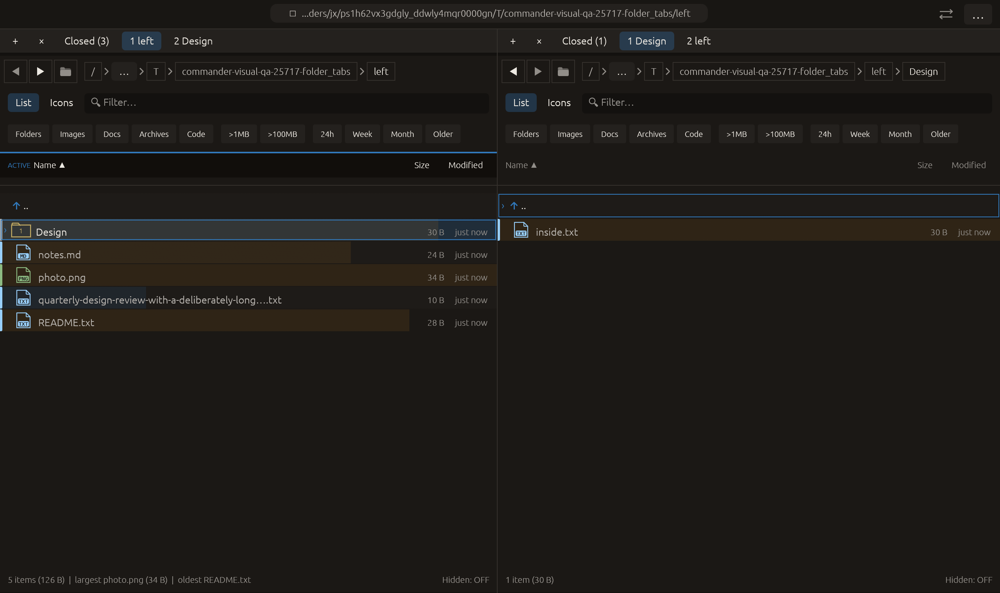

# Close a specific folder tab — 2026-10-27

Independent adaptation of [Krusader’s middle-button folder-tab closing](https://docs.kde.org/trunk_kf6/en/krusader/krusader/folder-tabs.html). No upstream code or dependency was copied.

## Behavior

Middle-click closes the pointed folder tab directly. Its context menu also offers Close this folder tab. The last tab in a pane remains open. Closed panels enter the existing bounded Closed history and can be reopened with runtime state and their prior position.

Closing an inactive tab never activates it, reloads the visible listing or clears its preview, filter, selection or cursor. The pane containing the tab need not become the globally active pane. Index correction preserves the visible slot when a preceding tab closes. Closing a visible tab uses existing neighbor selection and presentation reset. Invalid indices and pending modal/operation guards reject the change.

Tab-strip actions now own their activation before pointer activation is considered for the remaining pane body. This prevents a middle-button press over the strip from stealing pane focus while retaining body pointer activation. Slot changes remain queued until the tab strip finishes rendering.

## Verification

The full run before the subsequent pointer-focus fix passed **2393 tests, 3 ignored**. The first native attempt then exposed the pane-wide any-press activation rule stealing focus; that rejected native log is retained. After moving body activation below the tab strip and limiting its hit rectangle to the remaining body, the final **23 tab tests and 46 app-update tests passed**, including modal guard checks for closing specific active/inactive slots. Final all-targets Clippy with visual-qa and warnings denied, formatting and scoped whitespace checks passed. The entire suite was not repeated after this focused UI correction.

New workspace tests cover inactive slots before/after the active slot on both panes, unchanged pane focus, live path/filter/cursor/selection/preview preservation, exact saved-slot restoration via Closed, invalid/last-tab rejection, active-tab neighbor selection and the one-live-slot invariant.

Native macOS eframe folder_tabs retains its earlier group-close/background/copy/opposite-folder/Home/Root sequence. Raw middle-button input then closes the right pane’s inactive third tab. Capture requires exactly two right tabs, one recoverable closed right tab and unchanged left focus/current folders. The frame was visually inspected: left remains ACTIVE, right displays Closed (1) and its original active Design tab. All **14 manifest checks passed**, with zero recording native effects. This qualifies injected middle-button input through the actual UI, not a physical mouse/trackpad. The new context-menu Close this item shares the same queued operation but was not separately clicked natively. The 22-scenario matrix is unchanged; other native scenarios and remote CI were not rerun.

No commit or push was requested or performed.

