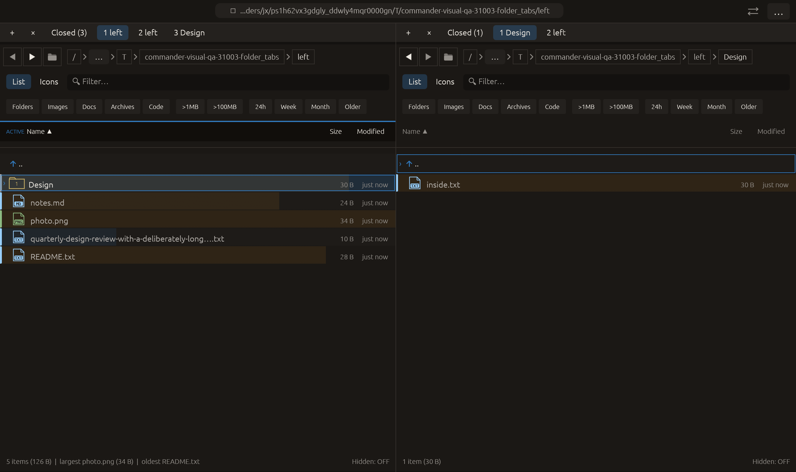

# Move a folder tab to the other pane — 2026-10-27

Independent adaptation inspired by [Krusader’s move-tab-to-other-panel operation](https://docs.kde.org/trunk_kf6/en/krusader/krusader/folder-tabs.html). Commander exposes a context-menu action; drag-and-drop and a new keyboard binding are not part of this change. No upstream code or dependency was copied.

## Behavior

Move this folder tab to other pane transfers the owned runtime PanelState into a background slot immediately after the destination’s active tab. It retains the tab’s directory, current view, selection, filter and navigation history. The source slot is removed without adding a Closed entry. Both Closed histories remain unchanged.

An inactive source moves without changing either visible folder. For a visible source, the existing previous/next neighbor becomes visible in the source pane, with the usual tab-switch preview reset. The destination’s active slot, current folder/filter/cursor/selection and global pane focus remain unchanged. Transferred watchers/jobs are suspended through the existing tab lifecycle; activation loads the destination slot normally. This preserves runtime state rather than making a fresh directory/view copy.

Keep at least one source tab and fewer than eight destination tabs. Invalid indices, capacity and existing pending-modal/operation guards reject the entire action before removal. No file operation is issued.

## Verification

Two added tests cover both source sides, three source positions and active/inactive moves, retained view/filter/selection/forward history, suspension, activation and actual forward navigation, unchanged destination selection/cursor/filter, unchanged file payloads, Closed histories, and atomic last-tab/index/capacity rejection. The existing modal test also checks transfer rejection.

The broad run recorded **2396 passed, 1 failed, 3 ignored**. The sole failure was an incorrectly placed test assertion: a modal-blocking assertion had been inserted in the duplicate-capacity test, whose opposite pane legitimately had room for a transfer. It was moved into the actual pending-modal test. On the corrected test source, **all 27 tab-module tests passed**, including the two runtime-transfer tests and the previously failing capacity test. Production code did not change after the broad run; the rejected log is retained. No fully green final broad rerun is claimed. Final all-targets Clippy with visual-qa and warnings denied, formatting and scoped whitespace checks passed.

Native macOS eframe folder_tabs retains prior actions, then opens the right inactive copied tab’s context menu and chooses Move this folder tab to other pane. Capture requires that slot at left index 1, removal from the right group, preserved current folders/left focus and both Closed histories. The frame was visually inspected: left now has three tabs, right has two, with left ACTIVE and right still showing Design. All **14 manifest checks passed**, with zero recording native effects. Native QA exercises an inactive move; active moves and runtime-state retention are covered by the workspace tests. The 22-scenario matrix is unchanged; other native scenarios and remote CI were not rerun.

No commit or push was requested or performed.

