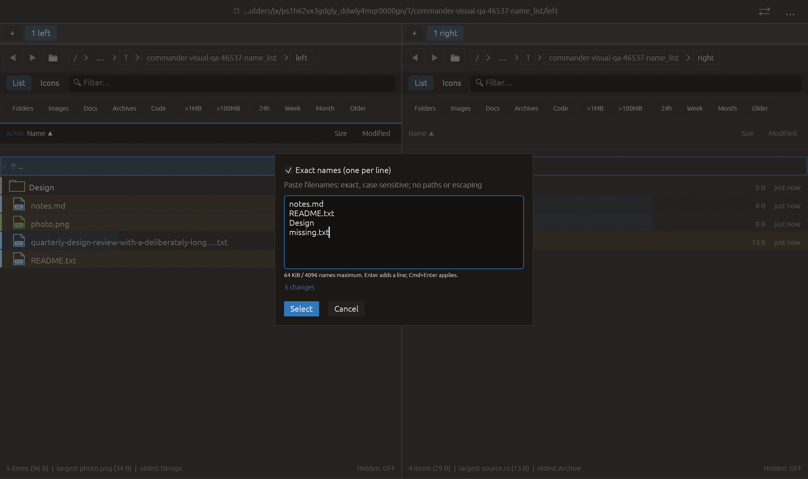

# Literal name-list selection — 2026-10-27

Independent adaptation inspired by [Double Commander’s Load Selection from
Clipboard](https://doublecmd.github.io/doc/en/help.html). Commander accepts a
user-pasted list in its existing selection dialog; it does not automatically
read the system clipboard. No upstream code or dependency was added.

## Behavior

Open Cmd+G and enable **Exact names (one per line)**. Paste basenames, review the
new-selection count, then use Select or Cmd+Enter. Enter inserts a line in this
mode. Cancel retains selection. Normal mask mode keeps its existing Enter and
last-mask behavior; reopening starts in mask mode. Name lists are not stored as
the last glob mask.

Names are exact and case-sensitive, with no glob expansion, escaping, trimming,
normalization or path traversal. Leading/trailing spaces, punctuation, ! and *
are literal. Empty lines are ignored and duplicate lines select an entry once.
LF and CRLF input is accepted. Non-UTF-8 native names do not match a lossy Unicode
replacement. Files and folders can match; the parent row cannot. Unknown names
are ignored. Selection is additive over the current filtered view only, retaining
existing picks inside and outside that view.

Parsing rejects the entire input before selection changes if it exceeds 64 KiB
or 4096 nonempty lines, includes / or NUL/embedded CR, or uses . / .. as names.
A terminal CR on a line is treated as a line ending; names containing LF or CR
cannot be represented. Backslash and tab remain literal POSIX filename content.
This is not a loader for full paths, URLs, shell quoting or Copy name's escaped
control-character notation. No recursive traversal or filesystem mutation occurs.

The live count uses the same parser and matching logic as application and reports
only newly selected entries. Validation errors disable Select and Cmd+Enter.
Count caching includes text, mode, folder, listing generation, shown-row count
and selection count. Input is bounded in the editor too; UTF-8 byte overflow is
still validated explicitly. The original mask-count cache tests remain passing.

## Verification

- Focused name-list tests: **4 passed**.
- Full regression: **2348 passed, 3 ignored**.
- All-targets Clippy with visual-qa and `-D warnings`: passed.
- Formatting and scoped whitespace checks: passed.

New tests cover CRLF, duplicate/empty lines, Unicode/no normalization, literal
wildcards and spaces, byte/line bounds, invalid paths, additive filtered selection,
case differences, directories, unchanged hidden-by-filter picks, exact live counts
and all-or-nothing rejection. Existing dialog/mask/cache tests remain passing.

Native **name_list** is a new case in the now **21-case** CI/README matrix. It
opens the production Mask modal with an empty field, uses actual pointer input
to enable names mode, and sends multiline text through the normal text input
path. Capture requires the literal buffer, three predicted changes and zero
actual selections. It does not click Select; application behavior is covered by
the real-listing panel tests. The macOS eframe/Glow frame was visually inspected;
all **16 manifest checks** passed, including modal ownership/background isolation.
No native clipboard/opener/trash calls occurred. No remote CI, commit, push or
performance gain is claimed.

