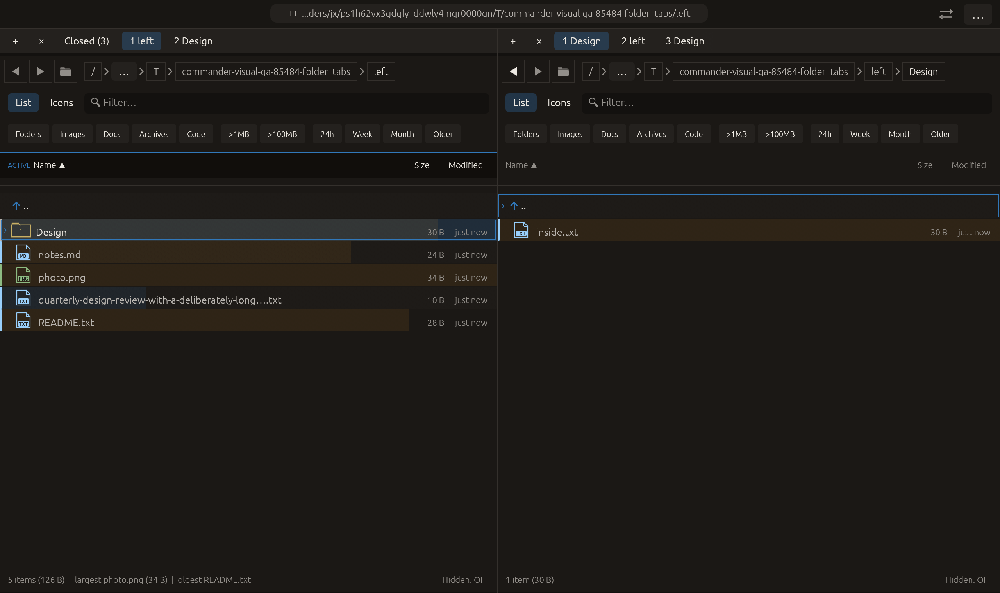

# Open highlighted folder in the other pane — 2026-10-27

Independent adaptation of [Double Commander’s TransferLeft / TransferRight commands](https://doublecmd.github.io/doc/en/cmds.html), which open the directory under the cursor in a specified panel. Commander chooses the opposite panel relative to the active source. No upstream code or dependency was copied.

## Behavior

Open highlighted folder in other pane is available in the command palette and folder-tab context menus. It navigates the destination’s current tab to the cursor directory, retaining source focus, source path, filters, cursor and selection. It does not create or switch tabs, so it works even with eight tabs in both panes. Other destination tabs remain intact. The menu explicitly describes the current pane’s highlighted folder, independently of which tab owns the context menu.

The destination exits any existing preview and uses normal directory navigation, including its own remembered views, loading/error handling and Back/Forward history. The previous destination folder remains reachable with Back. Navigation lock does not cause a second movement of the source. This browses directories; it does not transfer files or use the current-folder equalization command. Files, the parent row and an open operation confirmation block execution. The predicate is shared with the palette, and the workspace repeats the confirmation/directory checks at execution.

## Verification

- Full visual-qa regression: **2372 passed, 3 ignored**.
- Three added workspace tests cover both directions, navigation lock, filtered source selection/cursor retention, closing destination preview, Back/Forward, file/parent/confirmation rejection, full tab capacity and inactive-tab preservation.
- Final all-targets Clippy with visual-qa and warnings denied: passed.
- After the native fixture refinement, the four visual-qa contract/matrix tests passed. Formatting and scoped whitespace checks passed.

Native macOS eframe folder_tabs retains its prior group-close/background/copy interactions, then opens the source tab menu and clicks the new command. Capture requires the destination Design path, unchanged active source and both tab groups. The frame was visually inspected: Design is still highlighted in the left source, while inside.txt is listed on the right. All **14 manifest checks passed**, with zero recording clipboard/opener/trash/native menu effects. The existing 22-scenario matrix is unchanged; other native scenarios and remote CI were not rerun.

Rejected evidence is retained. The first compile missed a qualified Command name. The first focused test caught a real missing workspace confirmation guard; it was fixed before the full regression. The initial native fixture navigated successfully into an empty Design directory, but the capture harness requires nonempty listings; adding inside.txt makes the navigation visible and satisfies that established harness requirement. An intermediate fixture write used the wrong error type in the app constructor; it was moved into fixture creation before the final native/Clippy/QA checks. No failed check is counted as passing.

No commit or push was requested or performed.

