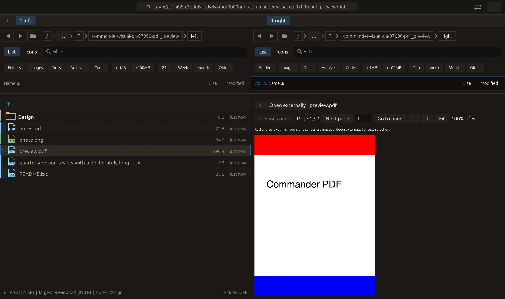

# Native PDF page preview — 2026-10-27

Independent implementation informed by [Kiorg ebook/PDF previews](https://github.com/houqp/kiorg/blob/main/crates/kiorg/src/ui/preview/ebook.rs).
Native API ownership and page transforms were checked against the installed Apple
SDK headers and Apple's [document creation](https://developer.apple.com/documentation/coregraphics/cgpdfdocument/init(_:)-gbq6?language=objc)
and [drawing-transform documentation](https://developer.apple.com/documentation/coregraphics/cgpdfpage/getdrawingtransform(_:rect:rotate:preserveaspectratio:)?language=objc).
No upstream application implementation was copied. Changes are local, uncommitted.

## Delivered

PDF files receive their own preview identity instead of a text-loader request.
macOS Preview workers read and rasterize one page at a time. Previous/Next,
direct page entry by button or Enter, Fit and 25–400% of Fit are available.
The bitmap is fixed at a maximum 2048-pixel long edge; zoom does not add detail.
Crop box and document rotation feed the native page transform. White-backed
sRGB RGBA pixels are uploaded on the UI thread. Close/Escape and normal file
following retain their existing owners; switching content/closing drops stale
receivers and textures. Read work and native objects stay off the UI thread.

Open externally uses the existing opener port. Links, scripts and forms are
inactive in the raster view. PDF text selection/search, annotations, password
entry, thumbnails and continuous multi-page scrolling remain outside this
feature. Native PDF rendering is macOS-only; other hosts say so and retain the
external-open button. DOCX/ODT/RTF parity remains open.

## Limits and ownership

- 64 MiB source cap, verified during chunked reads as well as against listing
  size. Regular-file metadata size/mtime is checked before and after the read.
  Preview uses these existing fingerprints, not a cryptographic freshness proof.
- 2048 pixels on the raster long edge (at most 16 MiB RGBA per rendered page),
  and at most 100,000 pages. These are source/output limits, not a total bound on
  Core Graphics' internal memory or CPU use.
- At most two concurrent PDF read/render jobs across panes. Provider admission
  and the existing image-preview rollout/runtime switch apply.
- UI waiting times out after 30 seconds. Reads check cancellation between chunks;
  a blocking filesystem/native call cannot be preempted. A stuck call can retain
  its worker/native slot until it returns. Stale results never replace new content.
- Each native document is created and released on its one worker. Borrowed page
  references and the data provider cannot outlive their backing document/bytes.
  No PDF document/page pointer is shared between worker threads.
- Source files are read only. Page changes currently reopen/reparse the source;
  no throughput, full-document compatibility or universal PDF security claim is made.

## Verification

- [Full suite](full-tests.log): **2247 passed, 3 ignored**, after PDF routing,
  raster, page-entry and lifecycle integration. The last non-macOS early-return
  and toolbar-spacing changes followed this run; the full suite was not repeated.
- [Final PDF tests](pdf-tests.log): **4 passed**. Native Core Graphics renders a
  real two-page generated PDF. First page uses an offset crop box with red top
  and blue bottom; exact pixel checks verify upright scaling/cropping. Second
  page has 90-degree rotation and a checked green pixel. Invalid page indices
  and damaged bytes fail. Worker tests reject stale/oversized/cancelled input.
  A headless UI sends Enter through the actual page field, awaits page 2 from
  a real worker, rejects page 0 without changing the shown page, and clears
  the cache on close.
- [Visual harness tests](harness-tests.log): **3 passed**, 12-case matrix including
  `pdf_preview`; CI configuration includes the new macOS scenario. CI was not
  run remotely here.
- [Final Clippy](clippy.log): all targets/features with warnings denied; passed.
  Formatting and whitespace checks passed.
- [Native manifest](pdf_preview/manifest.json): **14/14 checks**, 1280×760 logical
  pixels, 2× backing scale. The controller sends real egui pointer press/release
  events to Next and Previous and waits for **1 → 2 → 1** to finish before capture;
  [native log](native-run.log) records that verified round trip. The final frame
  shows the cropped upright first page and all page controls. All fake native
  effect counters remain zero; Open externally is not clicked.

## Rejected evidence

The first native raster was upright in neither orientation nor scale: it rendered
an unscaled centered document upside down. The corrected renderer explicitly
scales the point-space transform without flipping the bitmap context. The failed
pixel assertion and image are retained under `rejected/`.

The first QA pointer script moved to the required background-hover row between
button press and release, turning the intended click into a drag. PDF interactions
now suppress that movement only during the round trip and restore the mandatory
hover before capture. The failed timeout logs and diagnosis manifests are retained.
The screenshot timeout and glyph/geometry thresholds were not relaxed. An initial
compile failure and corrected Clippy style diagnostic are retained as well.

