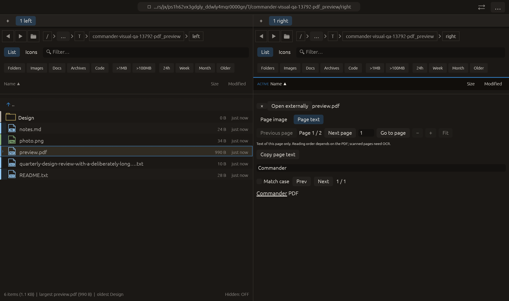

# PDF page text, search and copying — 2026-10-27

Continues the independently implemented [Kiorg-inspired PDF preview](https://github.com/houqp/kiorg/blob/main/crates/kiorg/src/ui/preview/ebook.rs).
Native extraction uses Apple's [PDFPage.string](https://developer.apple.com/documentation/pdfkit/pdfpage/string?language=objc),
[NSString byte-length API](https://developer.apple.com/documentation/foundation/nsstring/lengthofbytes(using:))
and [UTF-8 representation](https://developer.apple.com/documentation/foundation/nsstring/utf8string).
API declarations were also checked against the installed Apple SDK. No upstream
application implementation copied. Changes remain local and uncommitted.

## Behavior

**Page image / Page text** toggles the current PDF page between its image and
reflowed native text. Text is requested lazily on the existing Preview worker,
using the same bounded regular-file reader, metadata checks, provider admission,
concurrency guard and cancellation/result-discard rules as page images. Ordinary
image requests do not invoke PDFKit. Current-page image/text may be reused when
switching modes; switching the page retires both data slots.

The text view reuses Unicode literal search, case matching, next/previous match
and current-match underline. **Copy page text** emits the complete extracted page
as an egui clipboard command; the label is also selectable. Image zoom controls
are disabled in text mode. Search applies to this page, not the whole document.
Blank text layers produce a clear message. No OCR is requested, and no guarantee
of visual reading order, column reconstruction or exact PDF typography is made.
Text-copy restrictions reported by PDFKit are respected; no password bypass.

Copied text is capped at 256 KiB. Oversized output returns an error instead of
silently copying only a prefix. The exact UTF-8 byte length is used, preserving
embedded NULs in Rust rather than truncating at C-string termination. Native
page/string/document objects stay on their worker and release through RAII and
an autorelease pool. NSData owns a private input copy, so native retention cannot
outlive borrowed Rust storage. Native parsing allocations/CPU are not capped by
the text-output bound. Existing source/raster limits and non-preemptible native
call/timeout limitations still apply.

Only current-page text and one laid-out text buffer per pane are cached. Closing
or changing the PDF removes text, layout, find state and old result receivers.
Source files are read only. Non-macOS hosts retain the existing unsupported/native
PDF message and external opener.

## Evidence

- [Final PDF tests](pdf-tests.log): **7 passed**. Real PDFKit extraction returns
  the correct strings from page 1 and rotated page 2, empty text for a blank page,
  and errors for invalid pages/damaged data. NSString tests cover Unicode,
  embedded NUL and oversized byte/unit counts. Existing native raster, worker
  rejection and page-entry tests pass. A real headless pointer press/release on
  **Copy page text** emits the exact source string; Unicode find reports one match,
  leaves source/galley text unchanged, and close removes cached layout/find data.
- [Broader preview regression tests](preview-tests.log): **84 passed**, before
  switching the PDFKit input wrapper from borrowed bytes to owned NSData. Final
  PDF tests above cover that ownership change. Full workspace suite was not
  repeated for this scoped extension.
- [Final Clippy](clippy.log): all targets/features, warnings denied; passed.
  Formatting and whitespace checks passed.
- [Harness tests](harness-tests.log): **3 passed**, 12-scenario matrix unchanged.
- [Native capture](pdf_preview/manifest.json): **14/14 checks**, actual macOS
  framebuffer at 1280×760 logical pixels and 2× backing scale. The controller
  performs pointer hover/press/release on Next, Previous and Page text, waits for
  **1 → 2 → 1**, requests text, and requires exactly one `Commander` match before
  capture. [Native log](native-run.log) records those accepted actions. Native
  Copy is not clicked, so the host clipboard remains untouched; copying is checked
  through headless egui output. All recorded fake native-effect counters are zero.
- [Source hashes](source-sha256.txt) identify the inspected implementation files.
  No remote CI execution or all-PDF compatibility claim is implied.

Initial cache-removal compile diagnostics, a duplicate test/QA helper definition,
a corrected documentation lint and a failed pointer timing attempt remain under
`rejected/`. The first pointer script missed Previous after the control became
enabled. A hover frame now precedes each press/release; readiness, timeout and
capture geometry/glyph thresholds were not weakened.

