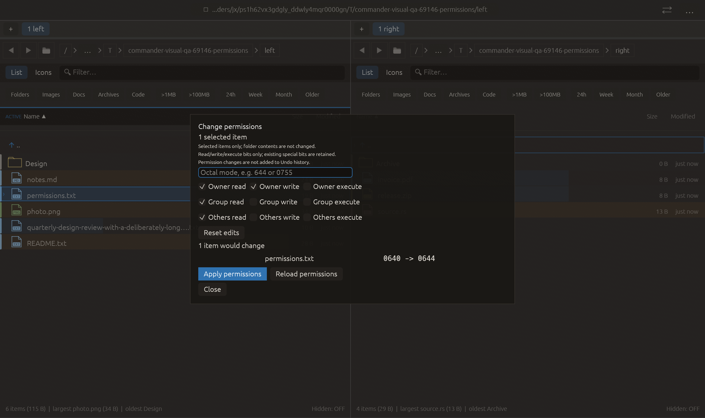

# Basic POSIX permissions — 2026-10-27

Independent adaptation of [Double Commander file properties](https://github.com/doublecmd/doublecmd/blob/master/src/fsetfileproperties.pas).
Local source changes only; no commit or publication is implied.

## Behavior and boundaries

Palette → **Change permissions** on Unix. Nine read/write/execute controls,
indeterminate mixed values, octal entry, reset, before/after preview and explicit
Apply. Only selected objects change; folder contents are not recursively visited.
Explicit parent/child and cross-folder selections are retained. Inspection and
commit run on workload workers; the modal reads cached volume policy while painting.

Listing/preview identity and mode are checked through a non-following descriptor
before chmod. Symlinks and special files are rejected. Missing foreign selections
remain visible errors. Explicit descendants apply before their selected ancestor.
Cancellation leaves completed work and reports partial results; a batch is not atomic.
Resulting modes are read back, and failures retain their paths in the report.

No Undo/journal, elevation, ownership, ACL or special-bit editor. Existing special
bits are included in the requested mode; filesystem deviations are reported.
A readable protected descriptor is required: an unreadable/mode-000 object may be
unavailable even to its owner. No path-based chmod bypass is used. Removing
owner-read is called out in the dialog. Hard-link aliases share their mode.

## Verification

- `cargo test`: 2233 passed, 3 ignored, before the final descendant ordering,
  preview-cache and cross-folder refinements; preserved in
  [full log](full-tests-before-final-refinements.log). This is not a claim that the
  full suite was rerun after those changes.
- Final `cargo test permission`: 17 passed. Covers non-recursion, real mode/content
  checks, explicit parent/child and missing cross-folder selections, foreign worker
  identity capture, replacement and symlink substitution, stale modes, unavailable
  plans, hard-link aliases, mixed masks and cooperative worker cancellation.
- Command tests: 47 passed; final all-target/all-feature Clippy passed with warnings
  denied. Formatting and whitespace checks passed.
- Visual-QA unit tests: 3 passed (11-scenario matrix).
- Real macOS native permissions capture: **16/16 checks**, 1280×760 logical pixels,
  2× backing scale, preview 0640 → 0644. All required glyph checks remain enabled;
  modal ownership, disabled background and geometry are checked. No Apply click is
  made in this native fixture; filesystem mutation is covered by the unit tests.
- Existing confirmation modal capture after the shared probe correction: **16/16**.
  Both captures record zero native-effect fake calls.

The first capture failed a glyph probe because its last-painted occurrence was
under the centered modal. The probe now keeps the first painted occurrence in a
frame. Required glyph checks were not relaxed. Rejected frame/manifest and logs
remain in `rejected/`, along with corrected Clippy diagnostic attempts.

