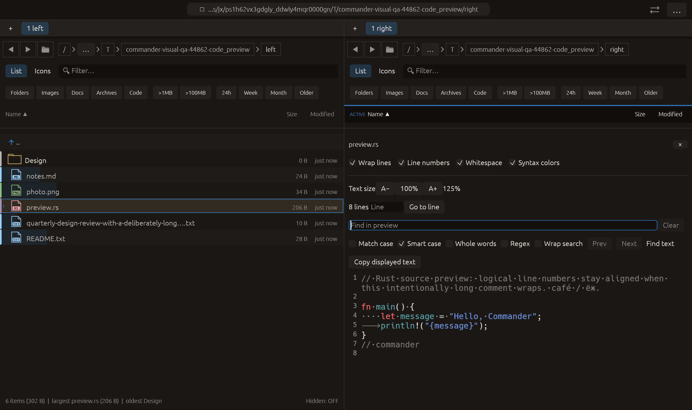

# Clear preview search — 2026-10-27

Inspired by [Yazi’s cancel-find/search action](https://yazi-rs.github.io/docs/configuration/keymap/#escape). Commander adapts the idea as a Clear button beside the preview query. No new Escape binding, upstream code or dependency introduced.

Clear empties the query, removes matches/highlights, resets navigation and stale errors, and cancels a pending/debounced regex job. Search options, displayed content and pane state remain. Focus returns to the query field. The button is disabled for an empty query. Shared preview search controls also provide it to other text viewers using this toolbar.

Verification:

- Initial focused compilation rejected a test-only nonexistent runtime type; corrected to the existing deterministic workload.
- Full suite: **2388 passed, 1 failed, 3 ignored**. The sole failure was the new pointer test dropping an egui TexturesDelta without the project cleanup helper. Test cleanup corrected; production unchanged.
- Final preview_find module: **22 passed**, including actual pointer click/focus/navigation assertions and cancellation of a queued regex job with option retention and no stale-result resurrection. No final full-suite rerun claimed.
- Final all-target Clippy with visual-qa and warnings denied passed. Formatting and scoped whitespace checks passed.
- Native code_preview preserves earlier font/whitespace/F3/wrap/smart-case interactions, waits for the mixed-case query to match once, then clicks Clear. Capture requires zero matches, disabled navigation, smart-case retained, displayed text, 125% size and whitespace markers retained. Screenshot inspected: empty focused query and disabled Clear fit inside the pane. All manifest checks passed with zero native side effects. Other native scenarios and remote CI were not rerun.

No commit or push performed. Rejected evidence retained.

