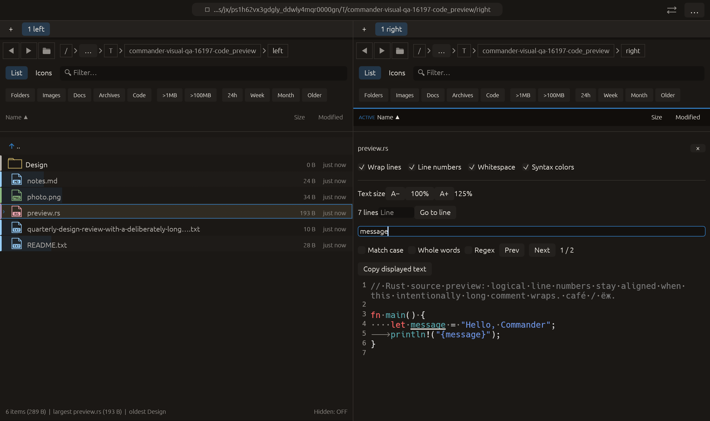

# F3 navigation in preview search — 2026-10-27

Independent adaptation inspired by [Double Commander’s viewer Find next / previous shortcuts](https://doublecmd.github.io/doc/en/shortcuts.html). No upstream code or dependency was copied.

## Behavior

With the Find in preview field focused, F3 advances to the next match and Shift+F3 goes to the previous one, using the existing cyclic match navigation and reveal behavior. Enter / Shift+Enter and Prev / Next retain their behavior. The button tooltips mention both key choices.

Consumption is scoped to the query field, preserving the application’s ordinary F3 preview command elsewhere. The shared toolbar also serves PDF text and formatted text modes; those modes were not separately exercised natively for this shortcut. The query, text contents, regex/literal matching, limits and cancellation rules are unchanged.

## Verification

- Preview-find module: **17 tests passed**. The new egui-input test verifies F3 navigation in both directions, wraparound at both ends, unchanged text and no consumption without query focus.
- Full visual-qa regression: **2388 passed, 3 ignored**.
- All-targets Clippy with visual-qa and warnings denied, formatting and scoped whitespace checks passed.

Native macOS eframe code_preview retains its 125% text size, whitespace markers, line numbers and two search matches. Pointer input focuses the query field; raw key/modifier events send F3 and Shift+F3. Progress waits for the actual selected-match indices 1 then 0, so capture cannot finish merely by injecting keys. The inspected frame shows the query focused, first of two matches selected and the source preview still open. All **14 manifest checks passed**, with zero recording native effects. The existing 22-scenario matrix is unchanged; other native scenarios and remote CI were not rerun.

No failed validation run occurred for this change. No commit or push was requested or performed.

