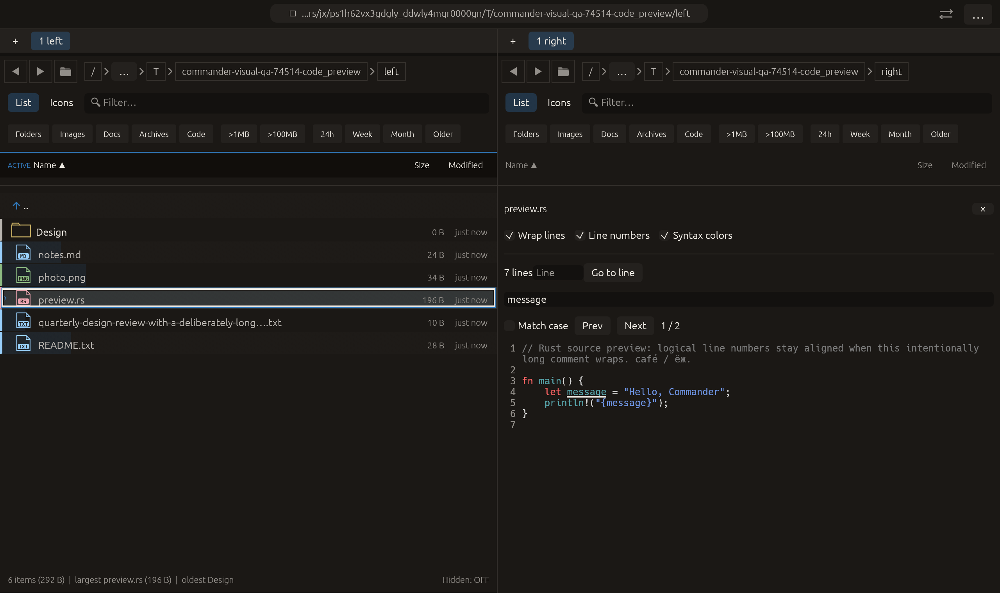

# Text preview line navigation — 2026-10-27

Independent adaptation of [Double Commander viewer line numbers and Go to line](https://github.com/doublecmd/doublecmd/blob/master/src/fviewer.pas).
The upstream source exposes `actGotoLine`, `cm_GotoLine` and the line-number gutter;
no upstream implementation code is copied. Changes remain local and uncommitted.

## Delivered behavior

Text and Source previews have a **Line numbers** toggle, logical line count and
**Go to line** field/button. Enter in the field jumps immediately. Out-of-range
input displays the permitted range without requesting a jump. Empty/trailing lines
count; wrapped continuations have no repeated number. Syntax coloring and find
continue over the unmodified source label. Painted numbers are separate from the
selectable text and do not enter its character offsets.

Markdown/HTML formatted output and CSV tables retain their normal layouts; their
Source views expose line controls. The toggle stays per pane for the current
session. Source identity changes reset the line query/index; galley changes rebuild
geometry. Cached indexes are shared instead of cloned each frame and painting is
limited to visible logical-line starts.

This is the existing bounded text preview, not a streaming viewer or editor.
No larger-file loading or binary support is implied. The gutter scrolls horizontally
with the source. No source file contents are changed.

## Evidence

- [Preview regression tests](preview-tests.log): **79 passed**, including actual
  Enter navigation to line 200, invalid-input rejection, Unicode/CRLF/empty/trailing
  lines, wrapping, cache reuse/reset, source/formatted accessibility controls,
  existing search, source colors, document/table and worker/cache behavior.
- [Clippy](clippy.log): all targets and all features, warnings denied.
- [Harness tests](harness-tests.log): three visual-QA tests, existing 11-case matrix.
- [Native capture](code_preview/manifest.json): real macOS framebuffer at 1280×760
  logical, 2× backing scale. Wrapped first line, empty second line, source numbers,
  syntax coloring and active `message` find shown together. All manifest checks
  passed; recorded native effects are zero. This capture checks display; the
  distant Go to line interaction is verified by the headless input/scroll test.
- Formatting and whitespace checks passed. The full workspace suite was not
  rerun for this scoped preview change.

The first distant-jump test failed because ordinary animated scrolling had moved
only 94 logical pixels after four frames. Go to line now requests immediate scroll,
matching the existing preview-find behavior. Rejected evidence is retained under
`rejected/`; the threshold was not weakened.

