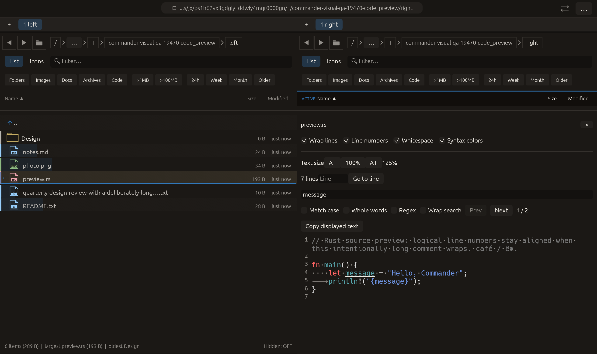

# Optional wraparound in preview search — 2026-10-27

Independent adaptation of [lf’s wrapscan preference](https://github.com/gokcehan/lf/blob/master/doc.md), applied here to displayed-text matches rather than lf’s file-list search. No upstream code or dependency was copied.

## Behavior

Wrap search defaults on, preserving existing cyclic Prev/Next, Enter/Shift+Enter and focused F3/Shift+F3 navigation. Disabling it stops navigation at the first or last collected match. Prev/Next availability uses the same boundary rule; empty and single-result searches have both buttons disabled when wrapping is off. A boundary key press is consumed within the query field but does not change the current match or request a new reveal.

The choice is session-local to the preview’s per-pane search state and retained across query/file changes. It does not reindex, reset the current match or cancel in-flight regex work. Existing matching limits remain: this controls navigation over the collected results, including a limited result set indicated by +. Text wrapping is independent of this search preference. The shared PDF/text toolbar receives the control, but PDF mode was not newly exercised natively.

## Verification

- Preview-find module: **18 tests passed**. A new pointer-driven test disables wrapping while on the last of two results and checks retained selection, disabled Next, F3 stopping at the end, Shift+F3 reaching/stopping at the start, and matching button states. Empty/single-result boundaries are checked too. Existing wraparound tests continue passing with the default.
- Full visual-qa regression: **2389 passed, 3 ignored**.
- Final all-targets Clippy with visual-qa and warnings denied passed. Formatting and scoped whitespace checks passed.

The initial compile’s moved Response values were corrected by recording enabled flags before consuming the responses; its rejected log is retained. Clippy then rejected a test-only single-range vec initializer. The fixture now pushes that one range explicitly; the final targeted test passed after this equivalent test-construction change. No production behavior changed after the passing full run.

Native macOS eframe code_preview retains the prior text-size, whitespace and keyboard-find sequence, then clicks Wrap search off. Capture requires the real button states [Prev disabled, Next enabled] at the first of two matches. The frame was visually inspected: Wrap search is unchecked, Prev is disabled and the preview/search highlights remain visible. All **14 manifest checks passed**, with zero recording native effects. The 22-scenario matrix is unchanged; other native scenarios and remote CI were not rerun.

No commit or push was requested or performed.

