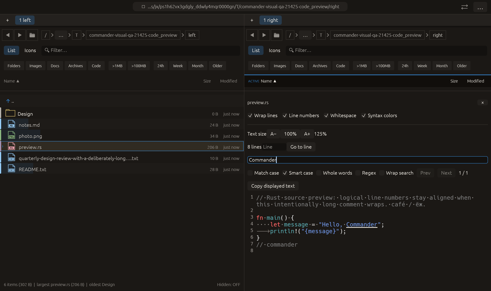

# Smart case in preview search — 2026-10-27

Independent adaptation of [lf’s smartcase search option](https://github.com/gokcehan/lf/blob/master/doc.md), applied to displayed-text search. No upstream code or dependency was copied.

## Behavior

Smart case makes the search case-sensitive when any query character is Unicode uppercase; otherwise matching ignores case. Explicit Match case has priority. For example, message matches message / Message / MESSAGE, while Message matches that exact case. Smart case defaults off to retain Commander’s prior behavior, independently of lf’s default, and remains in the per-pane session search state across file/query changes.

The effective case setting is shared by literal search and the background regex job. For regex, the uppercase check covers the entire raw query, including syntax; explicit inline regex flags still take precedence inside the pattern. This is not a regex-literal-only case detector or locale-dependent matching. Changing Smart case reindexes and cancels obsolete regex work through the existing path. Existing Unicode folding, whole-word, wrap, input limits, result cap and text-copy behavior remain intact. The shared PDF search toolbar also receives the control; PDF mode was not newly exercised natively.

## Verification

- Two focused tests passed: Latin/Cyrillic lower/mixed-case query behavior, default compatibility, manual override, cancellation of an obsolete regex job, whole-word composition and inline (?i) flags.
- Full visual-qa regression: **2391 passed, 3 ignored**.
- All-targets Clippy with visual-qa and warnings denied, formatting and scoped whitespace checks passed.

Native macOS eframe code_preview retains prior text-size, whitespace, F3 and wrap interactions. Pointer input enables Smart case and focuses the query; raw select-all/text input replaces message with Commander. The fixture contains both Commander and commander. Capture requires Smart case enabled and exactly one actual match. The frame was visually inspected: uppercase Commander is underlined, lowercase commander is not, and the unchecked manual Match case control confirms automatic mode. All **14 manifest checks passed**, with zero recording native effects. The existing 22-scenario matrix is unchanged; other native scenarios and remote CI were not rerun.

No failed validation run occurred for this change. No commit or push was requested or performed.

