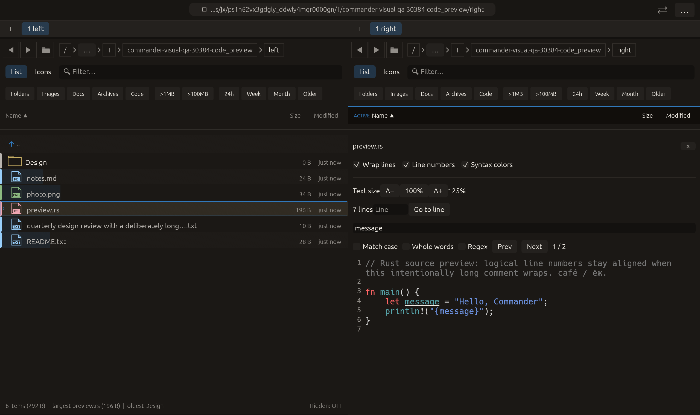

# Independent text size in previews — 2026-10-27

Independent adaptation inspired by [Double Commander’s viewer font-size
controls](https://doublecmd.github.io/doc/en/configuration.html). No upstream
code or new dependency was added.

## Behavior

A− / A+ change preview text magnification in 25 percentage-point steps between
50% and 200%; 100% resets it. Boundary buttons disable at the limits. Controls
have accessible action labels and wrap when space is limited.

The size is local to the current text viewer and pane, retained in session
memory across files. PDF page text has its own per-pane setting. Restarting
resets to 100%. This does not change application zoom or toolbar fonts.

Plain/source, syntax-highlighted and static formatted document text scale their
layout-job font sizes before layout. Heading sizes retain their ratios; text,
section ranges, font families and colors are retained. The layout cache includes
the scale, so a change reflows immediately while an unchanged view reuses the
galley. PDF text's layout cache similarly includes scale. Existing galley-based
line positions and find selection use the new layout; line-number glyph size
remains fixed. Search text is unchanged, so existing reflow handling retains
results instead of reindexing the same document solely for font size.

CSV/TSV table view, image previews and PDF page rasters are outside this text
control. Source mode for a CSV/TSV does provide it. No font-family selector,
mouse-wheel binding, persisted setting or scroll-anchor guarantee is introduced.

## Verification

- Broad preview-filter tests: **74 passed**.
- Full regression: **2339 passed, 3 ignored**.
- After adding further PDF reflow assertions to an existing test: **5 PDF tests passed**.
- Final all-targets Clippy with visual-qa and `-D warnings` passed.
- Formatting and scoped whitespace checks passed.

Tests click actual egui increase/decrease/reset controls, exercise both limits
and invalid stored bounds, and confirm pane independence. A formatted document
layout test checks text/range/family/color retention and relative font sizes.
The real text galley cache test checks re-layout, larger glyph geometry and
cache reuse. PDF page-text checks re-layout at 150%, unchanged text and retained
find matches; the existing copy and close/release assertions still pass.

Native code_preview clicks A+ through raw pointer input, requires stored 125%
and two search matches, then captures the actual macOS eframe/Glow frame. The
frame was visually inspected: syntax colors, wrapped text, aligned logical line
numbers and search remain visible. All 14 manifest checks passed. Native
capabilities report no clipboard/opener/trash calls. The scenario remains part
of the existing 20-case CI matrix. No remote CI, commit, push or performance gain
is claimed.

