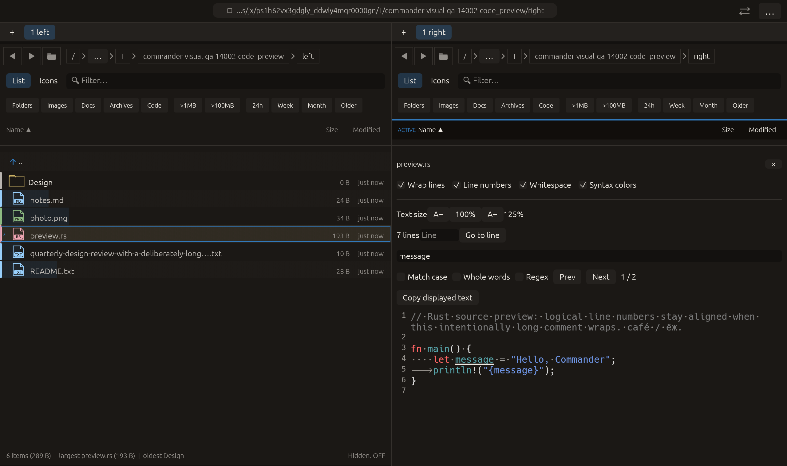

# Whitespace markers in text previews — 2026-10-27

Independent adaptation inspired by [Double Commander’s Show special characters editor option](https://doublecmd.github.io/doc/en/configuration.html). Commander applies the idea to read-only previews. No upstream code or dependency was copied.

## Behavior

Whitespace shows ASCII spaces as dots and tab characters as arrows in plain/source and JSON text preview modes. It defaults off and remains session-local to each pane, like other preview display controls. The setting is retained when that pane views another file. Rendered Markdown/HTML, delimited table and PDF preview modes do not gain this control in this change.

Markers are painter geometry positioned from the original galley’s glyph rectangles. The text, syntax sections, layout cache, selection, search offsets and Copy displayed text contents remain unchanged. The toggle does not replace tabs with spaces, change tab width or edit files. Markers follow wrapping/text size and are painted after search decorations. Vertical offscreen rows are skipped and glyph rectangles are checked against the viewport clip. Line-break and other Unicode whitespace markers are outside this feature’s scope.

## Verification

- Two focused tests passed: actual glyph geometry/counts, clip rejection, unchanged Unicode/tab source text, and pointer-driven default-off/pane-local state.
- Full visual-qa regression: **2387 passed, 3 ignored**. This includes the previously corrected copy-name-without-extension dispatch contract.
- All-targets Clippy with visual-qa and warnings denied, formatting and scoped whitespace checks passed.

Native macOS eframe code_preview now uses mixed space/tab indentation. Pointer input first selects 125% text size, then enables Whitespace. Capture requires both space and tab marker counts from actual painting, plus the existing two search matches and loaded text state. The frame was visually inspected: dots and a tab arrow are visible, syntax colors/search underlining and logical line numbers remain aligned. All **14 manifest checks passed**, with zero recording native effects. No system clipboard operation was performed. The existing 22-scenario matrix is unchanged; other native scenarios and remote CI were not rerun. No performance or assistive-technology qualification is claimed.

No failed validation run occurred for this change. No commit or push was requested or performed.

