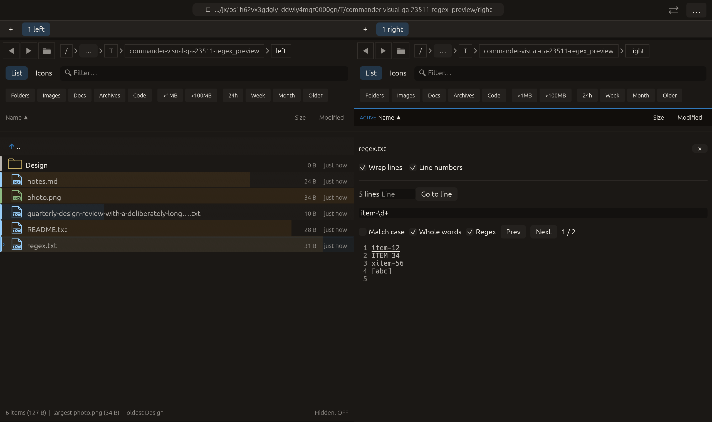

# Whole-word preview search — 2026-10-27

Independent adaptation inspired by the Whole words search mode described in the
[Krusader Handbook](https://docs.kde.org/trunk_kf6/en/krusader/krusader/krusader.pdf).
No upstream code or dependency was added.

## Behavior

**Whole words** now appears beside Match case and Regex. It defaults off and
works in both literal and regex modes, in the shared displayed-text search used
by source/plain/formatted previews and the current PDF page's extracted text.
Changing it reindexes the current text, resets navigation, cancels old jobs and
discards stale results. Prev/Next and keyboard navigation retain existing behavior.

The pattern is enclosed in noncapturing grouping with Unicode regex word
boundaries. This is regex word matching, not linguistic word segmentation:
letters, digits, combining marks, underscore and other Unicode word characters
belong to words. Thus cat does not match catalog, cat_name, cat2 or 猫cat.
Punctuation-only queries may have no word-boundary matches. Alternations remain
inside both boundaries. Explicit regex flags retain their scoped semantics.
A valid free-spacing expression ending in a comment gets a guarded newline
retry, so that comment cannot swallow the generated group terminator.

The limits remain 256 query characters, 4096 stored results and, for background
regex, 256 KiB of displayed text, 1 MiB regex/DFA budgets and nesting limit 32.
The generated group participates in that nesting limit. Match ranges use Unicode
character offsets for the existing galley selection/highlighting. No whole-file
text streaming, PDF-wide search, normalization or persistent find preferences
are claimed.

## Verification

Full regression: **2335 passed, 3 ignored**. After test assertion spelling and an equivalent native-input modulo check
were adjusted for Clippy, focused preview-search tests passed **16/16**.
Rejected Clippy logs are preserved under rejected/. These lint corrections
do not change search or input behavior. Final Clippy passed with all targets/visual-qa and `-D warnings`; all **3 QA
tests** passed after the equivalent input-check edit. Logs are retained.
Formatting and scoped whitespace checks passed.

Tests cover literal/regex word boundaries, case folding, Cyrillic, combining
marks, character offsets, alternation, trailing free-spacing comments, invalid
patterns, cancellation, stale-result rejection, navigation and existing caps.

Native regex_preview uses actual pointer input to enable Regex, waits for three
matches including xitem-56, then enables Whole words and requires two matches.
The final frame was visually inspected: the new control is checked, only the
standalone entries are highlighted, and navigation shows 1 / 2. All **14 native manifest checks** passed. The scenario remains in the existing 20-case CI matrix;
no remote CI, push, commit or performance gain is claimed.

