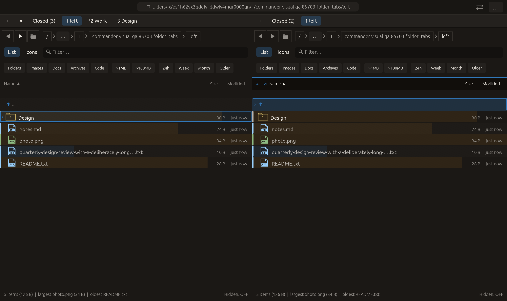

# Protect folder tabs from closing — 2026-10-28

Independent adaptation of [Double Commander’s exclusion of locked tabs from close groups/duplicate cleanup](https://doublecmd.github.io/doc/en/cmds.html). Commander introduces close protection independently of directory navigation locking. No upstream code or dependency copied.

Protect from closing is available in each tab’s context menu. Protected tabs carry an asterisk. Direct close, context close, the close toolbar button and middle-click closing are blocked. Close others/left/right groups skip protected entries; all-protected/no-eligible groups return without changing tabs or revision. Duplicate cleanup retains every protected instance; the duplicate count now counts only removable duplicates, so protected duplicates may remain. Current active-instance retention remains Commander’s existing priority rule.

Protection does not block navigation, tab switching, reordering or moving tabs between panes. It follows explicit duplication/group copying/moving and saved-session restoration. Unprotect before closing. Legacy/invalid protection metadata defaults to false without dropping tabs. Close command capability checks include protection, while Next/Previous tab retain their count-only gate. Pending modals also block changing protection.

Verification:

- Full local suite: **2417 passed, 0 failed, 3 ignored**. New matrix covers both panes, all four active positions and three group-close directions, protected direct-close denial, slot bindings and restoration order. Lifecycle regression covers protected duplicates/counts, duplication, group copying, cross-pane movement, JSON/active restoration and explicit unprotect/close. Existing modal guard includes protection changes.
- Final **2 targeted tests passed** after strengthening the all-protected atomic no-op assertions and applying a test iterator style repair. All-target Clippy with visual-qa and warnings denied passed; final formatting/scoped whitespace checks passed. Full suite predates those test-only refinements and the final tooltip wording update.
- Native folder_tabs extends title editing: opens the background Work tab’s menu, enables protection, dismisses the menu, then middle-clicks that tab. Capture requires actual protection=true, retained Work title/tab count, unchanged active indices/folders/histories and right-pane focus. All **14 checks** passed with zero native effects; screenshot inspected, asterisk visible. Native capture predates the final tooltip wording correction.
- Rejected evidence: Clippy requested enumerate() instead of an indexed range in the new regression; corrected and final checks passed. No failing full/native run in this feature.

Session serialization/restoration is tested; no real desktop process restart or path-locking behavior claimed. Other native scenarios and remote CI were not rerun. Existing native Root-navigation /.VolumeIcon.icns warnings remain in logs. No commit or push.

