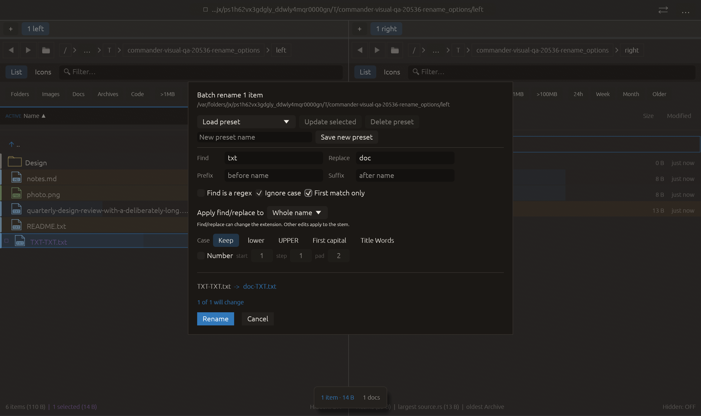

# Unicode capitalization in batch rename — 2026-10-27

Independent adaptation inspired by [Double Commander’s case modifiers](https://doublecmd.github.io/doc/en/multirename.html).
No upstream code or new dependency was added.

## Behavior

Two additional stem case modes are exposed in the batch rename dialog:

- **First capital**: uppercase the first Unicode scalar, lowercase subsequent scalars.
- **Title Words**: apply that conversion to each Unicode word-boundary segment using the existing unicode-segmentation dependency.

Examples: `hELLO wORLD.TXT` becomes `Hello world.TXT` or `Hello World.TXT`.
The last extension is preserved; directories have no protected extension.
Find/replace runs first, then case conversion, then prefix/suffix/numbering.
Both modes round-trip in named presets and invalidate the live validated-plan cache.
Clicking a case control participates in the existing Enter submission guard.
Case choices wrap when needed; numbering occupies its own row.

This uses Unicode scalar upper/lower mappings, not linguistic or locale-specific
title casing or normalization. Uppercase expansion is retained (`ß` becomes `SS`).
Unicode word rules retain internal underscores and certain punctuation:
`пРИВЕТ-мИР_тЕСТ` becomes `Привет-Мир_тест`, while the folder
`hELLO.wORLD` becomes `Hello.world`. Leading punctuation is not skipped by
First capital. Default Keep/lower/UPPER behavior and old saved rules are unchanged.

## Verification

Full regression before the final layout-only refinement: **2331 passed, 3 ignored**.
Focused capitalization tests cover Unicode/decomposed accents, expansions,
separator preservation, extension retention, operation ordering, presets,
validated-plan cache changes, and actual temporary-file rename with Undo/Redo.
Final focused tests: **5 passed**. Clippy with all targets/visual-qa and
`-D warnings`, formatting, and scoped whitespace checks passed. Native checks:
**16/16 passed**. Logs are retained alongside this report.

The initial focused run incorrectly expected a period inside a word to start a
new Unicode word. The expectation was corrected; its failed log is retained in
`rejected/`. Production word-boundary semantics were not changed to satisfy it.

The existing native `rename_options` scenario checks the final dialog layout and
its existing replacement-option interactions; it does not click the new case
controls. Their plan/submission behavior is covered by the focused tests.
The final screenshot is visually inspected for visible case choices, numbering,
preview, Rename and Cancel. No remote CI, commit or push is claimed.

