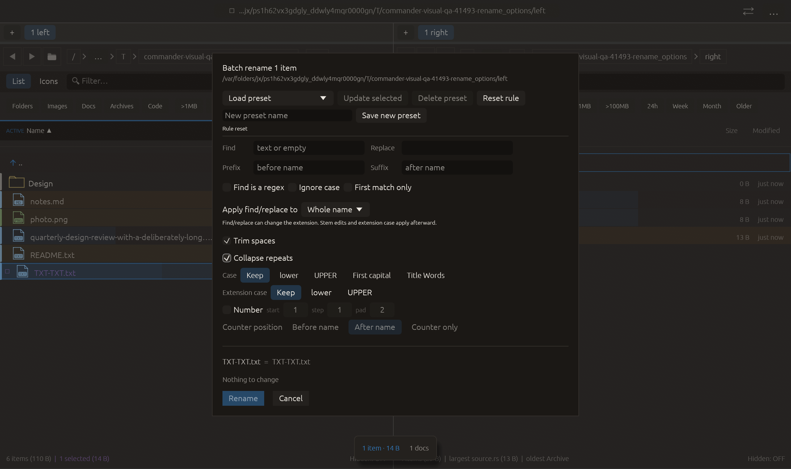

# Collapse repeated separators — 2026-10-27

Independent adaptation inspired by [Czkawka’s duplicated non-alphanumeric cleanup](https://github.com/qarmin/czkawka/blob/master/instructions/Instruction_CLI.md), cohort entry 81. No upstream code/dependency copied.

Collapse repeats reduces runs of identical non-alphanumeric Unicode graphemes to one in the final complete name, before Trim spaces. For example, report___final--v22.txt becomes report_final-v22.txt. Different adjacent separators remain intact, as do repeated letters/digits. Grapheme boundaries protect decomposed accented letters and joined emoji clusters. Repeated identical symbols (including emoji) are collapsed. The option is off by default, retained in presets, cleared by Reset rule, and omitted from default rule JSON. Name validity/collision validation applies to the resulting names.

Verification:

- Full local suite: **2387 passed, 0 failed, 3 ignored**. New tests cover files and directories, letters/digits, mixed separators, composed/decomposed Unicode letters, joined emoji, final decorations plus trimming, invalid dot results, collisions, legacy JSON and cached submission preview. Existing preset/reset tests now carry the enabled flag.
- All-target Clippy with visual-qa and warnings denied passed. Formatting and scoped whitespace checks passed.
- Native rename_options preserves preceding transforms/reset/trim interactions, then clicks Collapse repeats. The final actual rule requires both cleanup flags, and the already-clean fixture remains unchanged. All **16 checks** passed with zero native side effects. Screenshot inspected; controls and footer fit. Native coverage proves control wiring and clean-name preservation; dirty-name transformations are qualified by unit tests. Other native scenarios and remote CI were not rerun.

No failed checks occurred in this feature run. No commit or push performed.

