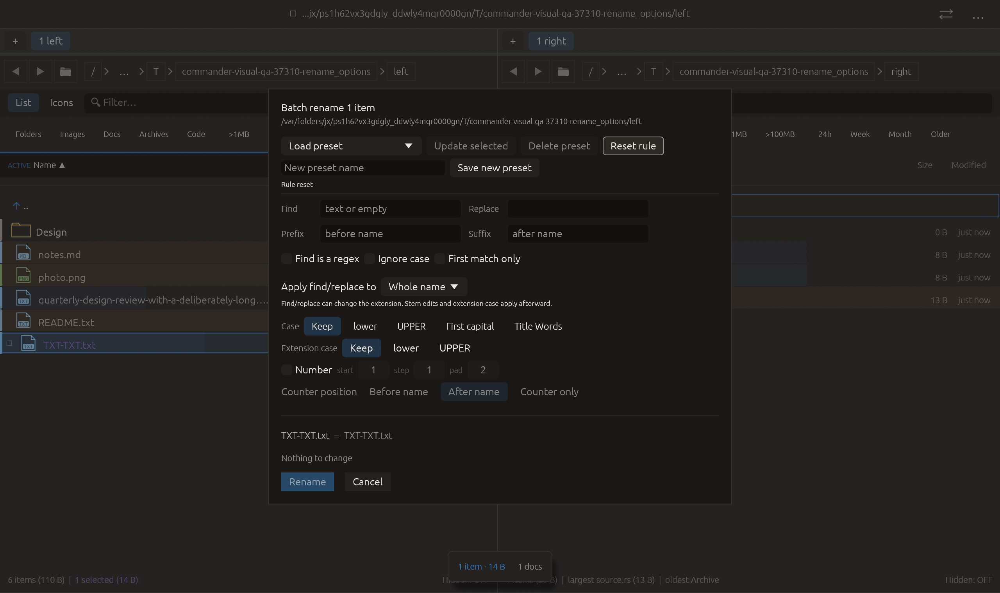

# Counter-only batch rename — 2026-10-27

Independent adaptation of the counter-only name mask supported by [Double Commander](https://doublecmd.github.io/doc/en/multirename.html). No upstream code or dependency copied.

## Behavior

Counter only replaces the decorated name stem with the formatted counter, retaining the resulting extension. Prefix and suffix are intentionally discarded in this mode; its tooltip explains this. For example, Photo.JPG becomes 001.JPG. Directories have no separate extension. Existing signed start/step/padding rules apply, including zero-step collision detection. When numbering is disabled, this setting has no effect. The mode round-trips through named presets; old rules retain After name. Reset rule returns to the old default.

## Verification

- Full local suite: **2383 passed, 0 failed, 3 ignored**. Includes counter-only files/directories, absent extensions, signed values, zero-step collisions, cached submission preview and preset round-trip coverage.
- All-target Clippy with visual-qa and warnings denied passed. Formatting and scoped whitespace checks passed.
- Native rename_options now clicks Counter only after the preceding matching/case/signed-counter transitions. Advancing to Reset requires the actual preview to become -03.txt. It then resets and captures the unchanged-name preview. All **16 checks** passed; zero native side effects. Source fixture remains present. Screenshot inspected: new option fits inside the dialog. The final image shows the reset state, not the intermediate counter preview.
- The first focused compilation rejected a misspelled test-only enum name (RenameStatus instead of PlanStatus). Corrected before the full suite; rejected log retained.

The existing 22-scenario matrix remains intact; only rename_options was run natively for this change. Remote CI and other native scenarios were not rerun. No commit or push performed.

