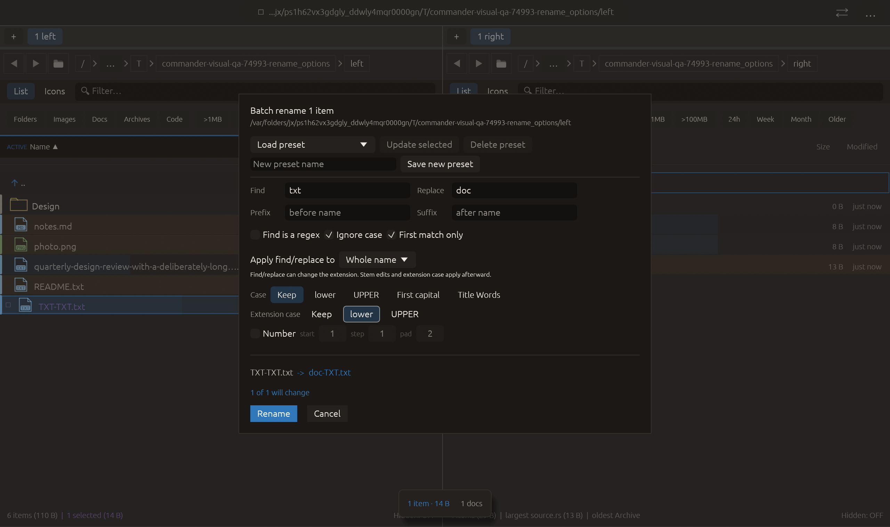

# Independent extension case — 2026-10-27

Independent adaptation inspired by [Double Commander’s multi-rename tools](https://doublecmd.github.io/doc/en/multirename.html), combining separate name/extension generation with case conversion. This does not claim that upstream exposes this exact independent control. No upstream code or dependency was copied.

## Behavior

Batch rename now offers Extension case: Keep / lower / UPPER, independently from stem case. Keep remains the default, including old saved rules. Named presets round-trip all three choices. Conversion applies to the resulting last extension after find/replace, excludes its dot, and leaves the stem untouched. Directories have no separate extension. Extensionless names and single-component dotfiles remain unchanged; only the last part of compound extensions changes. Unicode conversion follows Rust mappings and may expand characters; it is not locale-specific.

The existing planner rejects collisions before applying. Case-only changes use the existing operation engine and Undo/Redo, preserving file payloads. Prefixes, suffixes, numbering and stem transformations continue to compose with extension conversion.

## Verification

- Five focused tests passed: conversion matrix/order, legacy rules and collision blocking, saved presets, cached preview transitions, and a real temporary-file case-only rename with Undo/Redo and payload checks.
- Full visual-qa regression: **2364 passed, 3 ignored**.
- All-targets Clippy with visual-qa and warnings denied: passed after correcting documentation markup.
- Native macOS eframe rename_options: **16 checks passed**, zero recording native effects. Pointer input switches UPPER then lower and waits for each actual cached plan. The source file remains unchanged. The captured frame was visually inspected; the selected lower option, resulting preview and both action buttons are visible.

The initial collision test incorrectly expected the unchanged row to be marked Collision. The planner correctly marks the changing row Collision and the untouched row Unchanged; the assertion was corrected and the rejected log retained. The first Clippy log is retained too. The 22-scenario CI matrix is unchanged; only rename_options was run natively for this change. No remote CI, commit or push is claimed.

