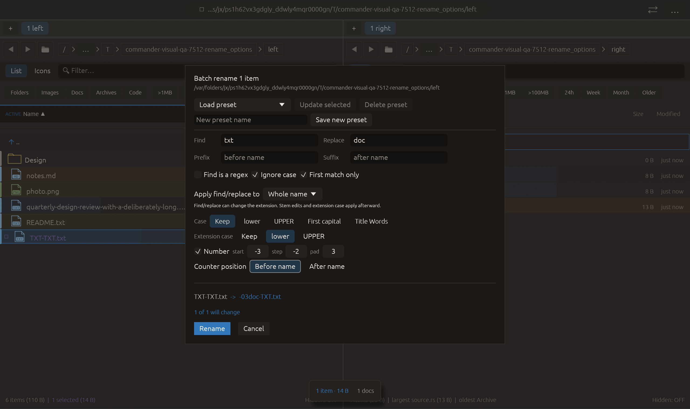

# Batch-rename counter position — 2026-10-27

Independent adaptation inspired by [Double Commander’s counter placeholder and freely composed rename mask](https://doublecmd.github.io/doc/en/multirename.html). Commander adds two explicit positions; this does not claim full mask/template parity. No upstream code or dependency was copied.

## Behavior

With Number enabled, Counter position offers Before name / After name. The number is placed outside the decorated stem: before prefix + transformed stem + suffix, or after that combination. The final extension remains after the complete name. For example, start 3, pad 2 and prefix _ yield 03_Photo.jpg in Before name mode. No separator is inserted automatically. Directories retain whole-name stem semantics.

After name is the default, preserving existing rule output and old saved rules that omit the new field. The default field is omitted when serializing. Presets save and restore the choice independently of whether numbering is enabled; a disabled counter emits no number. Existing signed start/step, sign-aware padding, ordering, name validation, collision checks and Undo/Redo are retained. Changes rebuild the actual cached preview before submission.

## Verification

- Three focused tests passed before the real-file test was added.
- Full visual-qa regression: **2382 passed, 3 ignored**.
- Four new tests cover composition with fixed prefix/suffix, stem and extension case, signed descending values, directory names, disabled numbering, legacy JSON/default omission, preset round trips, cached-plan updates, and a real two-file leading-counter rename with byte-preserving Undo/Redo.
- All-targets Clippy with visual-qa and warnings denied, formatting and scoped whitespace checks passed.

Native macOS eframe rename_options retains the existing replacement, extension-case and signed-number interactions, then clicks Before name. Capture requires the actual leading-counter rule and cached preview −03doc-TXT.txt. The frame was visually inspected: Before name, the changed preview and Rename/Cancel are visible. All **16 manifest checks passed**, with zero recording native effects; native QA does not apply the rename. The 22-scenario matrix is unchanged; other native scenarios and remote CI were not rerun.

No failed check occurred for this change. No commit or push was requested or performed.

