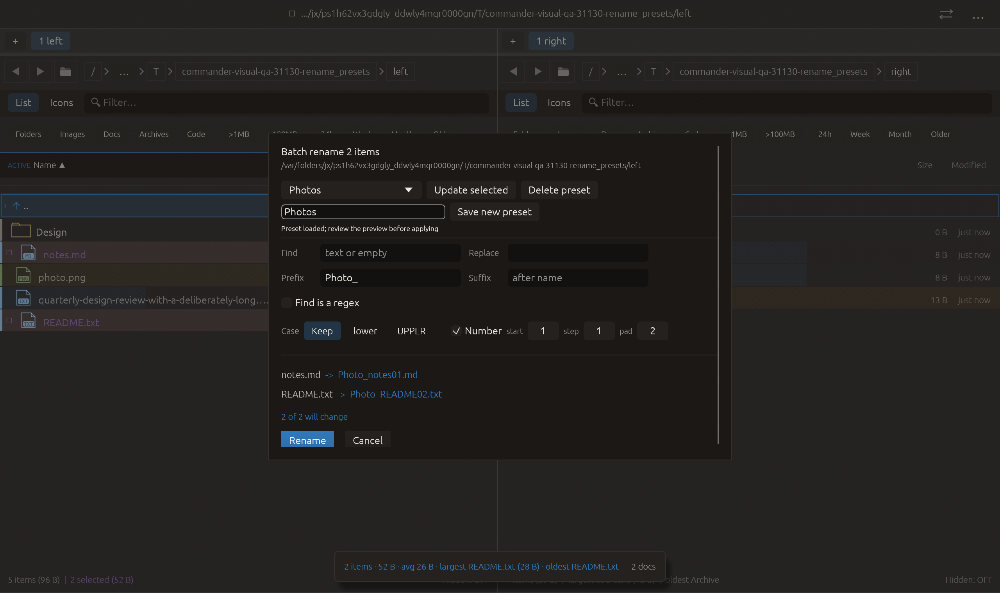

# Saved batch-rename rules — 2026-10-27

Independent adaptation of [Double Commander multi-rename presets](https://github.com/doublecmd/doublecmd/blob/master/src/fmultirename.pas).
No upstream implementation copied. Changes remain local and uncommitted.

## Workflow and limits

The batch-rename sheet now saves named rules, loads them into a fresh/current
preview, explicitly updates a selected saved rule or deletes it. Find/replace,
literal/regex mode, prefix/suffix, case and active counter settings round-trip.
Targets and paths stay in the live rename context, not in the preset. Loading
never submits a rename; existing validation, collisions, order, rollback and Undo
remain owned by the original rename engine. Cancelling the sheet does not discard
independently saved preset edits.

The name editor, preset selector and preset buttons are excluded from global
Enter submission, including the frame in which a single-line edit loses focus.
The normal Rename button still applies the currently reviewed plan. The sheet has
an outer viewport-bounded scroll area; the existing row preview remains virtualized.

Up to 32 presets live in the existing session store. Names are trimmed and NFC
normalized, 1–64 characters, without controls; lowercase/NFC duplicates cannot be
silently overwritten by Save new. Update selected explicitly replaces only its
rule, retaining its label. Rename presets themselves by saving under a new name
and deleting the old one; no separate label-renaming action is claimed.

Each saved text field is limited to 4096 UTF-8 bytes. Regexes must compile;
counter start/step/padding must fit editor ranges 0–100000 / 1–1000 / 0–6. The
collection is validated during deserialization before any load can fill the
editor, preventing hostile counter padding from reaching name formatting.
Invalid preset data fails the session gate closed rather than silently deleting
entries. Legacy sessions without presets restore an empty collection.

Preset edits immediately attempt the existing atomic session save, on the same
settings-persistence path used by the app. This is not a new background I/O
pipeline. Existing recovered/corrupt/future/stale-revision gates are honored.
Failure or missing durability is reported, and in-memory edits remain available;
the UI does not claim a durable save when the owner rejects it. The format is
Commander's session format; Double Commander preset import/export is not included.

## Verification

- [Full suite](full-tests.log): **2257 passed, 3 ignored**, after preset/session,
  UI loading and Enter-guard integration; before final minimum field widths and
  ASCII preview-marker changes. Full suite was not repeated for those UI fixes.
- [Rename tests](rename-tests.log): **113 passed**, including saved-rule
  round-trip/update/deletion/duplicate rejection, bounded rules, existing rename
  validation/collisions/rollback/Undo and operation-owner checks.
- [Session tests](session-tests.log): **20 passed**, including a real atomic
  write/reload of a named numbered rule, legacy absent-field compatibility and
  refusal to overwrite original session bytes after invalid preset data.
- [Final dialog tests](final-dialog-tests.log): **14 passed** after layout/marker
  corrections. [Final Clippy](clippy.log): all targets/features with warnings
  denied; passed. Formatting and whitespace checks passed.
- [Harness tests](harness-tests.log): **3 passed**, matrix now 13 scenarios;
  `rename_presets` added to macOS CI configuration. No remote CI execution claimed.
- [Native manifest](rename_presets/manifest.json): **16/16 checks**, actual macOS
  framebuffer, 1280×760 logical / 2× backing scale, modal owner **BatchRename**,
  disabled background and correct modal layer. Pointer hover/press/release opens
  the saved selector, loads `Photos`, focuses the preset name and sends Enter.
  Readiness requires the loaded prefix/counter and both original files still
  present with the modal open. The frame shows two preview changes and the
  unpressed Rename button. All fake native-effect counters are zero. The native
  scenario does not click Save/Update/Delete or apply a filesystem rename;
  disk persistence and preset collection mutations are verified by unit tests.
- [Source hashes](source-sha256.txt) identify the inspected implementation files.

The initial capture passed automated checks, but visual inspection found grid
fields squeezed to a narrow column and unsupported Unicode preview markers.
Minimum edit widths and ASCII markers correct those issues. That original frame
and manifest remain under `rejected/narrow-grid/`; the initial test-only persistence
constructor compile error is preserved too. No capture checks were relaxed.

