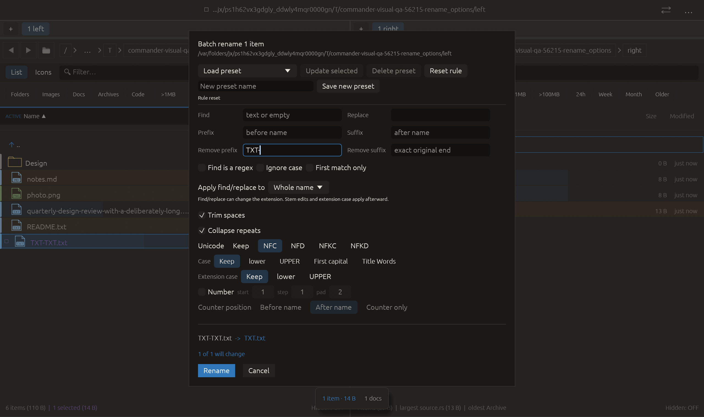

# Remove original prefix/suffix in batch rename — 2026-10-27

Independent adaptation of [rclone trimprefix/trimsuffix](https://github.com/rclone/rclone/blob/master/lib/transform/transform.md), cohort entry 87. No upstream source or dependency copied.

Remove prefix and Remove suffix remove one exact case-sensitive occurrence from the beginning/end of the original complete name, prefix first. They precede find/replace and extension splitting: backup_photo.jpg.old becomes photo.jpg and later extension edits target jpg. These controls are independent of the find/replace case and regex toggles. Empty fields do nothing; absent affixes leave a name unchanged. They apply to folders too, round-trip in presets, respect existing 4096-byte preset field bounds and are cleared by Reset rule. Defaults omit both empty fields in JSON. Existing validation checks the resulting name.

Verification:

- Full local suite: **2398 passed, 0 failed, 3 ignored**. New coverage checks once-only/exact case matching, original-extension removal, folders/Unicode, later decorations and extension case, empty-name rejection, collisions, legacy defaults, preset round-trip/size bounds and cached preview/submission. Existing reset coverage starts with both removal fields populated.
- All-target Clippy with visual-qa and warnings denied, formatting and scoped whitespace checks passed.
- Native rename_options retains prior actions, focuses Remove prefix and types TXT-. The final actual rule requires this field and preview TXT-TXT.txt → TXT.txt. All **16 checks** passed with zero native side effects. Screenshot inspected: added row and footer fit, Rename enabled, original fixture retained. No rename is applied. Suffix transformation is covered by unit tests; native text entry specifically covers prefix.

No failed checks occurred. Other native scenarios and remote CI were not rerun. No commit or push performed.

