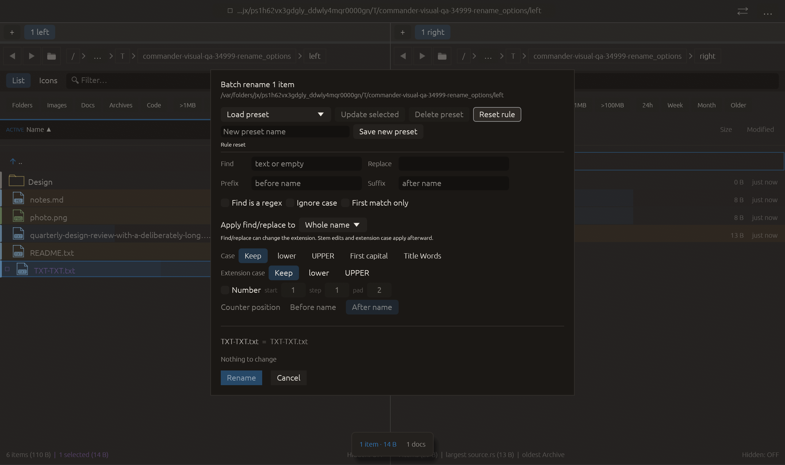

# Reset the current batch-rename rule — 2026-10-27

Independent adaptation inspired by [Double Commander’s Reset all multi-rename action](https://doublecmd.github.io/doc/en/shortcuts.html). Commander adds a button; no new reset hotkey is introduced. No upstream code or dependency was copied.

## Behavior

Reset rule clears current find/replace, regex/matching options, replacement scope, prefix/suffix, stem/extension case, numbering and counter placement. Inactive counter controls return to start 1, step 1, pad 2. The draft preset name and selected-preset association are cleared, leaving saved presets available for reuse; the reset path does not mutate the preset collection.

Stale validation and prior apply-error text are discarded, and Rule reset confirms the action. The existing file context, listing-generation binding and dialog scroll identity are retained. Rebuilt default preview leaves every target name unchanged, so Rename is unavailable. Reset does not apply an operation, close the sheet or recapture a different selection. Preset-interaction focus guarding includes the new button.

## Verification

- The focused state/validation test passed: nondefault settings including invalid regex, stale error/validation, selected/draft preset and negative counter values reset completely; context targets/generation/scroll identity stay unchanged. The rebuilt unchanged-name plan cannot submit.
- Full visual-qa regression: **2398 passed, 3 ignored**, including the corrected cross-pane tab guard test from the previous transfer.
- All-targets Clippy with visual-qa and warnings denied, formatting and scoped whitespace checks passed.

Native macOS eframe rename_options retains the prior ignore-case/first-only/extension-case/signed-counter/leading-position sequence, then clicks Reset rule. Capture requires the actual default rule, initial counter values, detached preset and cached unchanged-name/nonapplicable plan. The frame was visually inspected: cleared controls, Rule reset, identical old/new name and disabled Rename are visible. The source fixture remains present and the previously proposed destination is absent. All **16 manifest checks passed**, with zero recording native effects. The 22-scenario matrix is unchanged; other native scenarios and remote CI were not rerun.

No failed validation run occurred for this change. No commit or push was requested or performed.

