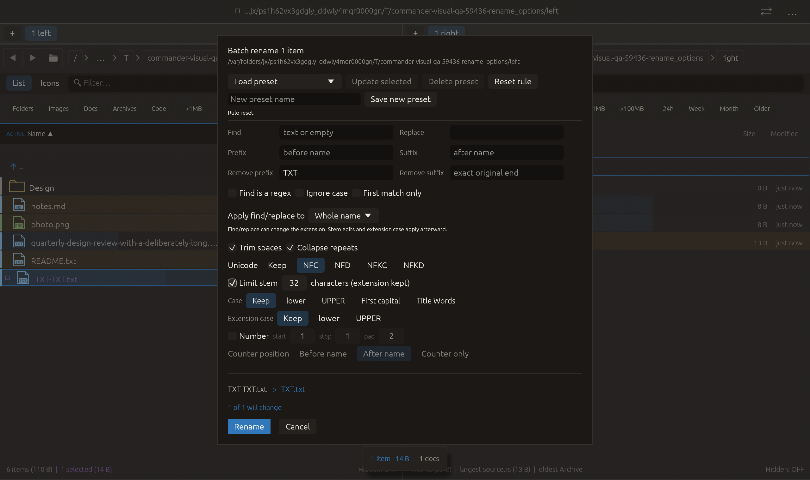

# Limit final name stem — 2026-10-27

Independent adaptation inspired by [rclone truncate_keep_extension](https://github.com/rclone/rclone/blob/master/lib/transform/transform.md), cohort entry 87. Commander exposes a stem-only limit measured in extended grapheme clusters, rather than promising rclone’s exact total-name character semantics. Uses the existing unicode-segmentation dependency; no upstream code/new dependency copied.

Limit stem keeps at most 1–255 complete Unicode graphemes before the last extension, after all other transforms, including decorations and normalization. Thus abcdef.txt at limit 2 becomes ab.txt; archive.tar.gz becomes ar.gz. Directories have no separate extension. Hidden names without another dot are whole stems. Composed/decomposed accents and joined emoji are not split. The limit does not guarantee filesystem byte length; normal validity and collision checks still apply. Off by default, saved in presets, reset to an inactive limit of 32. Unsupported preset bounds are rejected.

Verification:

- Full local suite: **2401 passed, 0 failed, 3 ignored**. New tests cover files/directories/hidden/multi-extension names, Unicode graphemes, short names, final-decoration order, collisions, legacy defaults, cached submission preview and preset limits/round-trip. Existing reset test starts with limiting enabled.
- All-target Clippy with visual-qa and warnings denied, formatting and scoped whitespace checks passed.
- Native rename_options retains its previous prefix-removal preview, enables Limit stem and requires the actual final rule to hold Some(32). The short TXT.txt result is preserved. All **16 checks** passed, zero native effects; screenshot inspected, controls/footer fit. Actual shortening is covered by unit tests; native coverage tests enabling and preservation below the threshold. No rename is applied.

The first native manifest passed but visual inspection rejected its partly clipped footer (rejected-clipped-frame.png retained). Cleanup toggles were placed on one wrapped row; native capture and all-target Clippy reran successfully. The final screenshot has fully visible Rename/Cancel buttons. Full suite predates this layout-only repair; no production transformation changed.

Other native scenarios and remote CI were not rerun. No commit or push.

