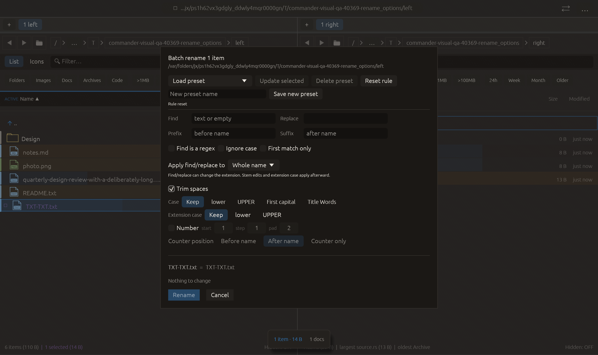

# Trim spaces in batch rename — 2026-10-27

Inspired by [Czkawka bad-name cleanup](https://github.com/qarmin/czkawka/blob/master/instructions/Instruction_CLI.md), cohort entry 81. Independent implementation; no upstream source/dependency copied.

Trim spaces removes Unicode whitespace from both ends of the final complete name after other transforms, retaining internal spaces. It applies to files and directories. It is off by default, saved in named presets and cleared by Reset rule. Legacy JSON defaults to off and omits the field when false. Whitespace immediately before an extension is internal and stays intact.

Verification:

- Full local suite: **2385 passed, 0 failed, 3 ignored**. New coverage exercises Unicode/ASCII whitespace, files/directories, internal spaces, final decorations, empty-name rejection, collisions, legacy defaults and cached submission preview. Existing preset round-trip and reset tests now carry an enabled trim flag.
- All-target Clippy with visual-qa and warnings denied passed. Formatting and scoped whitespace checks passed.
- Native rename_options retains prior matching/case/counter transitions, verifies Reset has rebuilt the default unchanged preview, then clicks Trim spaces. The final actual rule differs from default only by trim_spaces=true; the already-clean fixture name stays unchanged. All **16 checks** passed, zero native side effects. This native fixture validates control wiring and preservation of a clean name; trimming dirty names is covered by the unit suite. The other 21 native scenarios were not rerun.
- Retained rejected evidence: the first native script accidentally required the counter preview after Reset and timed out. Clippy also flagged the then-unused reset-preview helper. Corrected the phase gate, retained both logs, and reran successfully. No production behavior changed for that repair.

No commit, push or remote CI run performed.

