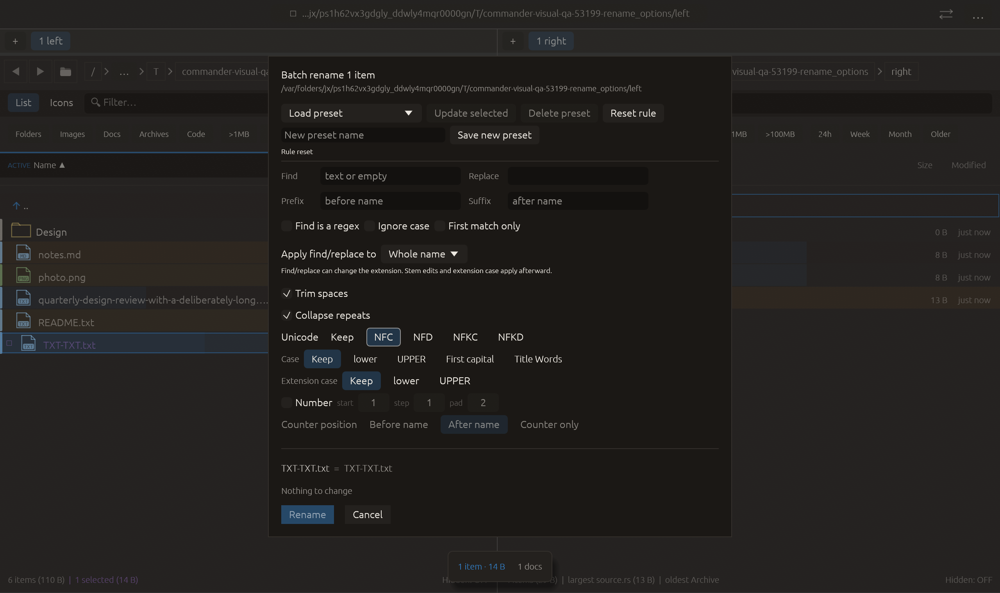

# Unicode normalization in batch rename — 2026-10-27

Independent adaptation of [rclone name-transform normalization forms](https://github.com/rclone/rclone/blob/master/lib/transform/transform.md), cohort entry 87. Uses the existing unicode-normalization dependency; no upstream source or new dependency copied.

Unicode offers Keep, NFC, NFD, NFKC and NFKD. Keep is the legacy/default value and omitted from default serialized rules. Normalization applies to the complete final name after every preceding transformation, including prefix/suffix, extension, counter and cleanup. Canonical forms compose/decompose accents; compatibility forms also convert characters such as circled digits and full-width letters. The tooltip explains this distinction and filesystem form enforcement. Presets retain all five choices; Reset rule restores Keep. Existing validity, length and collision checks evaluate the normalized result.

Verification:

- Full local suite: **2395 passed, 0 failed, 3 ignored**. New tests cover all four forms for files/directories, idempotence, normalization across decoration boundaries, slash/dot results rejected after compatibility conversion, collisions, legacy defaults, preset round-trip and cached submission preview. Existing reset test starts with NFKD enabled. This full run includes the preceding copy-tab-path regression.
- All-target Clippy with visual-qa and warnings denied, formatting and scoped whitespace checks passed.
- Native rename_options retains the previous sequence and clicks NFC after Reset/cleanup toggles. Capture requires the actual final NFC rule with both cleanup options and an unchanged already-normalized ASCII name. All **16 checks** passed, zero native effects; screenshot inspected, controls/footer fit. Native coverage proves option wiring; non-ASCII transformations are qualified by unit tests.

No claim that a filesystem will retain the chosen byte representation: storage systems may enforce their own normalization. No real-file normalization rename, other native scenarios or remote CI run performed. No failed checks, commit or push.

