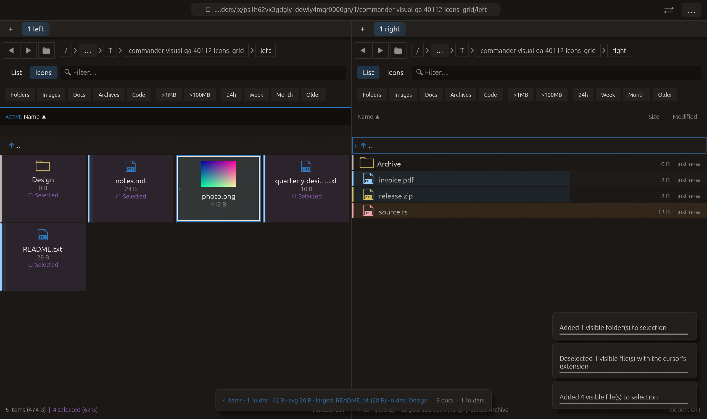

# Selection groups and extension subtraction — 2026-10-27

Independent adaptation inspired by [Double Commander’s marking attribute
filters](https://doublecmd.github.io/doc/en/configuration.html) and
[same-extension unselection](https://doublecmd.github.io/doc/en/help.html).
No upstream code or dependency was added.

## Behavior

Three command-palette entries are available:

- **Add visible files to selection** adds non-directory entries from the filtered view.
- **Add visible folders to selection** adds directory entries from the filtered view.
- **Deselect files like cursor (same extension)** removes matching visible files from the existing selection.

All compose with current selections. Entries outside the current filter retain
their selection state; the other pane and cursor remain unchanged. Parent rows
are not real entries and are excluded. Selection by kind uses the existing
is_dir classification, including its established treatment of symlinks; this is
not a newly introduced filesystem type resolver or recursive operation.

Extension subtraction uses exactly the existing last-extension representation
used by Select files like cursor. It does nothing on a parent, folder or
extensionless file. Folders named with that suffix are never removed. Matching
is against the listing's normalized extension, not MIME/UTI or compound archive
extensions. It reports the number actually removed, so repeated use is a no-op.
File/folder addition similarly reports only new selections.

Availability shares existing visible-entry/file and cursor-extension gates;
there are no new default shortcuts. Folder addition can remain available in a
files-only listing and then report zero additions. These commands modify only
interactive selection, not files or the independent marked-files set.

## Verification

Full regression: **2345 passed, 3 ignored**. The focused command-composition
integration test also passed independently. Final all-targets Clippy with visual-qa and `-D warnings` passed; all **3 QA
tests** passed after the readiness refinement. Formatting and scoped whitespace
checks passed. Logs are retained alongside this report.

New panel tests combine a real-file listing, text filter, pre-existing hidden-by-
filter selection, uppercase extension, folder with a .txt suffix, repeated
commands, an extensionless cursor and the parent row. Workspace tests exercise
all three production commands and confirm cursor/opposite-pane preservation and
availability rejection on a directory cursor.

Native icons_grid waits until photo.png is actually the cursor entry, invokes
the three production commands through Workspace::execute, and requires exactly
four selections: Design and the three non-PNG files; photo.png is not selected.
It does not drive the command palette with pointer input. The actual macOS
frame was visually inspected, and all **14 manifest checks** passed. Native
capabilities report no clipboard/opener/trash calls. The scenario remains in the
existing 20-case CI matrix. No remote CI, commit, push or performance gain is
claimed.

The initial native run invoked the commands immediately after requesting focus;
background listing publication had deferred that focus, leaving the cursor on
no file. A diagnostic run established cursor=None and all five entries selected.
The corrected scenario waits for the actual photo.png cursor before executing,
without changing production selection behavior or relaxing timeout thresholds.
Rejected logs/manifests are preserved. A diagnostic compile attempt also used a
test-only selected_paths accessor; that log is preserved and the temporary log
was changed to a runtime accessor before the successful diagnostic run.

