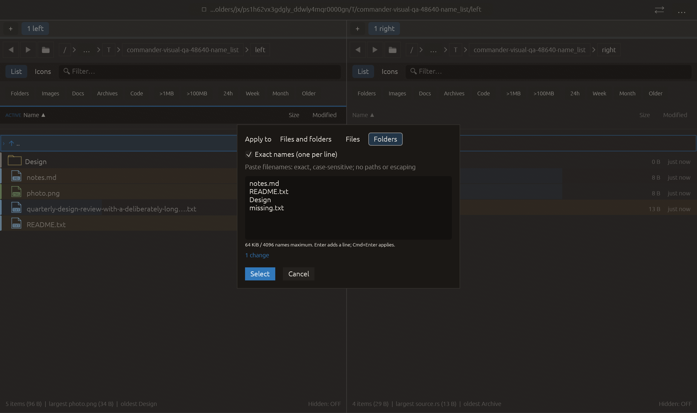

# Restrict group selection to files or folders — 2026-10-27

Independent adaptation inspired by [Double Commander’s independent attribute
filter in the mask input dialog](https://doublecmd.github.io/doc/en/configuration.html).
No upstream code or dependency was added.

## Behavior

Cmd+G offers **Apply to: Files and folders / Files / Folders**, shared by mask
and exact-name-list modes. Every new dialog starts at Files and folders,
preserving the previous default. Changing the target retains input, revalidates
and recomputes the live count immediately. The target is temporary dialog state,
not a persisted setting and not the panel's visible-row filter.

Files restricts both positive and subtractive mask terms to non-directory rows;
Folders restricts them to directory rows. Existing selections of the other kind
remain untouched, even if their names match a negative term. Exact-name lists
remain additive and use the same target check in preview and application. Names
are still validated in full before any selection change, regardless of target.
Entries hidden by the current panel filter retain their existing selection.
No recursive filesystem inspection is added: kind follows the listing's existing
is_dir classification, including its established symlink behavior.

Target/mode controls participate in the dialog's Enter guard, so keyboard
interaction with them cannot simultaneously submit the list. The Select button
and the established mask Enter / name-list Cmd+Enter actions apply the currently
selected target. Cancel retains the original selection. The cache key includes
target, avoiding a stale count when only Files/Folders changes. Existing callers
of the unscoped panel helpers retain Files and folders behavior.

## Verification

- Focused target matrix test: passed.
- Full current regression: **2349 passed, 3 ignored**.
- All-targets Clippy with visual-qa and `-D warnings`: passed.
- Formatting and scoped whitespace checks: passed.

The real-listing matrix exercises all three targets with exact-name preview and
application, positive and negative masks, repeated no-ops, non-target selections,
selected entries outside a text filter, and atomic invalid-list rejection. The
existing cache test now also verifies invalidation and reuse across target changes.

Native name_list uses actual pointer input: paste a mixed list with two files,
one folder and one absent name; require three preview changes; choose Files and
require two; choose Folders and require one. Capture requires the original list
and zero actual selections, confirming that choosing a target only edits the
preview. The actual macOS eframe/Glow frame was visually inspected. All **16
manifest checks** passed with no native clipboard/opener/trash effects. This
extends the existing name_list case in the 21-case CI matrix; it does not click
Select. Scoped application is checked on real temporary listings by the matrix.
No remote CI, commit, push or performance gain is claimed.

