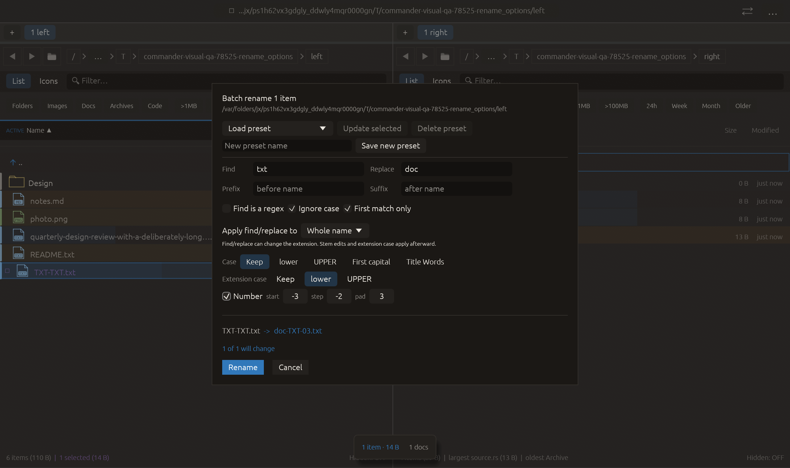

# Signed batch-rename numbering — 2026-10-27

Independent implementation inspired by [Double Commander’s counter placeholder, which accepts negative numbers](https://doublecmd.github.io/doc/en/multirename.html). No upstream code or dependency was copied.

## Behavior

The batch-rename counter now supports negative starts and descending steps. Start 3, step −2, pad 3 yields 003, 001, −01, −03. Padding counts the minus sign in the total width. A zero step repeats one value. Counters remain appended to the resulting stem, before the last extension, in the existing input order. Existing positive defaults and operation ordering are unchanged.

The editor and preset validator support start −100000…100000, step −1000…1000 and pad 0…6. Signed choices persist in named presets and restore without converting negative or zero steps to 1. Raw rule deserialization accepts previous u32 values. Start and step are represented as i64 and calculation widens to i128 before multiplication/addition, avoiding wrap on supported 32/64-bit targets. The existing planner handles invalid names and collisions before applying.

## Verification

Full visual-qa regression: **2369 passed, 3 ignored**. Five added tests cover descending sequences and zero crossing, sign-aware padding, zero step, directory stems, legacy u32 values, arithmetic at i64/usize limits, preset round trips, cached plan changes and an actual three-file rename with payload checks and Undo/Redo. All-targets Clippy with warnings denied, formatting and scoped whitespace checks passed.

Native macOS eframe rename_options: **16 manifest checks passed**, with zero recording native effects. Existing replacement and extension-case interactions are retained; a pointer click then enables Number on seeded signed fields. Capture requires the actual rule start −3 / step −2 / pad 3 and cached preview doc-TXT-03.txt. The frame was visually inspected: signed fields, preview and Rename/Cancel are visible. This native case checks enabling the control and the resulting preview; descending multiple-file behavior is covered by the real-file test. Source fixtures are not renamed by native QA. The 22-scenario matrix is unchanged; other native scenarios and remote CI were not rerun.

Rejected logs retain initial test argument-order mistakes and the first preset round-trip failure. The latter exposed the old zero-step rejection; preset validation now matches the signed editor ranges. Neither failed run is counted as a passing check. No commit or push was requested or performed.

