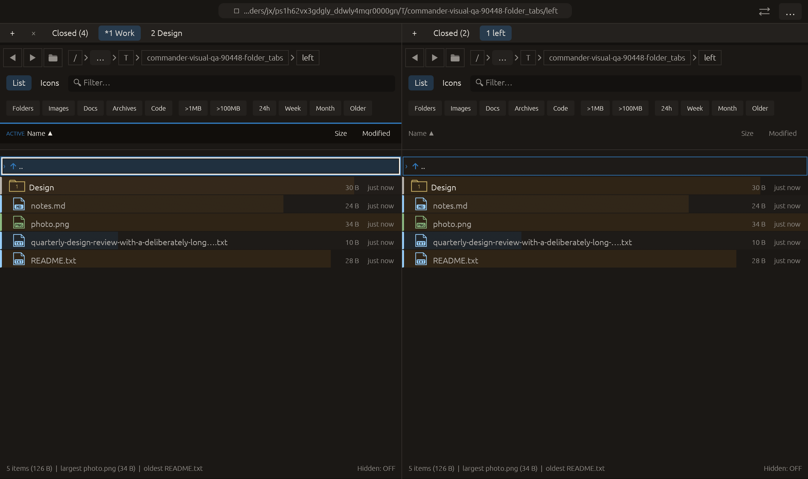

# Duplicate-tab retention priority — 2026-10-28

Independent adaptation of [Double Commander duplicate-tab priorities](https://doublecmd.github.io/doc/en/help.html). No upstream code copied. Commander retains every protected copy. For a path without protected copies, a custom title wins, followed by the active copy among ties, then the first copy. Paths use exact existing path equality without filesystem probes. This is not directory locking or full Double Commander parity.

If cleanup removes the active ordinary copy in favor of a named/protected peer, that peer becomes visible with its own runtime selection and filter. Removed panels retain their original positions in the existing bounded closed-tab history (eight entries). Multiple protected copies intentionally remain. The menu tooltip explains the rule and its count reflects only removable copies.

Verification:

- Full local suite: **2419 passed, 0 failed, 3 ignored**. New regressions exercise both panes, named/protected runtime-state retention, closed-tab recovery, equal-title active preference and deterministic selection in another path group. Existing protection lifecycle expectations updated for the new priority.
- All-target Clippy with visual-qa and warnings denied passed. Formatting and scoped whitespace checks passed.
- Native folder_tabs performs duplicate cleanup through the context menu after naming/protecting Work. Capture requires protected Work to replace the ordinary active copy, left tab count two, closed history four, and the other pane's retained state. **14/14 manifest checks passed**, zero native effects. Screenshot inspected: protected Work, Design and Closed (4) are visible. Native process completed and generated the captured manifest; its log has no explicit success footer.

Saved evidence includes logs, framebuffer, manifest, capabilities and source hashes. Existing launch-path and /.VolumeIcon.icns warnings are retained. Other native scenarios, a real process restart and remote CI were not rerun. No commit or push.

